# 发布前迭代任务与分支映射（统一实施索引）

- 唯一设计输入：`.ai-bridge/release-iteration/UNIFIED_RELEASE_DESIGN.md`（批准设计固化）
- 唯一实施计划：`.ai-bridge/release-iteration/PLAN.md`（本文件的切片规格/波次/DAG/串行表/验收/回滚定义）
- 更新日期：2026-08-12
- 执行载体：主代理规划/派遣/审查/合并/验收/结论判定；实现 Agent（AtomCode → `deepseek-v4-flash`）在隔离 worktree 作业，只改「允许文件」、运行范围内验证、写切片报告；**实现 Agent 不执行 git lifecycle（不 commit/push/branch/merge）**；Git 操作全部由主代理执行且每个 commit/branch/merge 前 `python3 support/scripts/git_operation_audit.py record ...`
- 状态图例：`planned`（未启动）/ `in_progress`（worktree 作业中）/ `merged`（主代理合并）/ `blocked`（外部依赖不可得，如实记录）/ `superseded`（历史/并入，不作为活动切片）
- 活动切片计数：**49 个实现/研究切片**（P0、BASE-1、CF-1..3、PR-1..14、PR-CBM3/4、PROV、C0A–C8B、V-1、DOC-1、PR-9、C8C）+ **12 个执行节点**（C_final、N0–N9、N10）；13 个波次（W0–W12）
- 工作树纪律（冻结）：历史现存 worktrees（final-* 系列）为 pre-design/superseded，**不自动复用**；执行前由 P0/BASE-1 做 current worktree/branch/commit/dirty reconciliation，输出复用/归档/新建决策；**同名分支禁止直接重建**（先 audit 决策）；当前 dirty 36 项定义为 pre-P0 用户/代理 work，不得删除，由 BASE-1 按文件 ownership 分流（归切片→该切片审查、共享文件→主代理审查、明确排除→记录）。
- 结论口径（冻结，与 PLAN §2/§14 一致）：**未签名技术预览=同一候选 commit/source digest 双平台证据全绿（N0–N10 绑定 C_final）即本轮发布完成**；`release_ready`=全部 MUST/证据绑定满足时为 true（不含签名要求）；`distribution_ready_public` 保持 false 不阻断；任一关键证据缺席/失败 → blocked。旧版「技术预览保持 `release_ready=false`」结论已废弃，不在本文件出现。
- 已废弃口径（不出现）：旧权威顺序、10%、整批回滚、禁止自证、Detection-only 必须 routed-flow、Optical 永久 preview、unsigned 无条件视为完成、onboarding 6 步、`needs-choice`/`selection_required` 作为活动状态。

## 1. 切片状态索引（活动）

### 1.1 契约冻结波（W1，严格串行）

| ID | 切片 | 分支 / worktree / PR | 波次 | 依赖 | 状态 | 说明 |
|---|---|---|---|---|---|---|
| P0 | preflight-baseline | `codex/final/preflight-baseline` / `final-preflight-baseline` / PR-P0 | W0 | — | planned | 执行基线冻结；只读复核 + 冻结报告 |
| BASE-1 | baseline-absorption | `codex/final/baseline-absorption` / `final-baseline-absorption` / PR-BASE1（主代理审查执行） | W0 | P0 | planned | dirty 36 项按文件 ownership 分流审查/提交或明确排除；实现基线冻结；历史 worktrees 不自动复用、同名分支禁止直接重建 |
| CF-1 | contract-freeze-types | `codex/final/contract-freeze-types` / `final-contract-freeze-types` / PR-CF1 | W1 | P0 | planned | dtoken-types 合同冻结（配置合同/receipt 类型/ConfigTransactionState/WritePolicy/AgentCapability/十字段/IR 骨架） |
| CF-2 | contract-freeze-core | `codex/final/contract-freeze-core` / `final-contract-freeze-core` / PR-CF2 | W1 | CF-1 | planned | core-api 合同面冻结（状态机推进/十字段/receipt 投影/词表映射） |
| CF-3 | contract-freeze-registry | `codex/final/contract-freeze-registry` / `final-contract-freeze-registry` / PR-CF3 | W1 | CF-1 | planned | CandidateEvidenceEnvelope schema + Agent 四来源并集矩阵 + §3.6 词表登记 |

### 1.2 功能切片（W2–W3）

| ID | 切片 | 分支 / worktree / PR | 波次 | 依赖 | 状态 | 说明 |
|---|---|---|---|---|---|---|
| PR-1 | runtime-receipt | `codex/final/runtime-receipt` / `final-runtime-receipt` / PR-1 | W2 | CF-2 | planned | Provider usage→RequestLog→OptimizationReceipt；cost 口径收口（C10）；N1 producer |
| PR-2 | codex-ocxlocal-acceptance | `codex/final/codex-ocxlocal-acceptance` / `final-codex-ocxlocal-acceptance` / PR-2 | W2 | CF-3 | planned | Codex 真实 routed-flow producer（N2）；C8 关闭 |
| PR-3 | autoconfig-cutover | `codex/final/autoconfig-cutover` / `final-autoconfig-cutover` / PR-3 | W2 | CF-1/2/3、PR-13（前端链串行） | planned | 一次点击配置/逐 Agent 独立事务/词表/幂等/O2 阶段回调/清除 needs-choice（C2/C3）；拥有 i18n 键 |
| PR-4 | ui-polish | `codex/final/ui-polish` / `final-ui-polish` / PR-4 | W2 | CF-3 | planned | §4.4 小范围修复（shell/pages/nav/sidebar/样式；glob 排除 Topbar/AppShell/Onboarding/Install；不新增 i18n 键，消费 PR-3 键） |
| PR-6 | config-acceptance | `codex/final/config-acceptance` / `final-config-acceptance` / PR-6 | W2 | CF-1/2/3 | planned | 隔离临时根配置验收 harness（A12；N4 前置） |
| PR-10 | codex-toml | `codex/final/codex-toml` / `final-codex-toml` / PR-10 | W2 | CF-1/2/3、PR-13（config-patcher 串行槽） | planned | Codex TOML 配置形态闭环（agent_transport.rs Codex 模块） |
| PR-11 | openclaw-adapter | `codex/final/openclaw-adapter` / `final-openclaw-adapter` / PR-11 | W2 | CF-1/2/3、PR-10（config-patcher 串行槽） | planned | OpenClaw multi-provider adapter 闭环（agent_transport.rs OpenClaw 模块） |
| PR-13 | hot-sync | `codex/final/hot-sync` / `final-hot-sync` / PR-13 | W2 | CF-1/2/3 | planned | cc-switch 只读热同步完整循环 + 授权门 + 原子快照（cc_switch.rs；config-patcher 链 PR-13 先行；前端链 PR-13→PR-3→PR-14） |
| PR-14 | onboarding-5seg | `codex/final/onboarding-5seg` / `final-onboarding-5seg` / PR-14 | W2 | CF-3、PR-13→PR-3（前端链串行） | planned | Onboarding 五段（O1/O3/C4）；Topbar/AppShell 入口接线；消费 PR-3 i18n 键不新增 |
| PR-CBM3 | cbm-manifest-v2 | `codex/final/cbm-manifest-v2` / `final-cbm-manifest-v2` / PR-CBM3 | W2 | CF-3、PROV | planned | 五正式版 manifest v2 + rc.1 prerelease 标记 + 平台矩阵（C7 部分） |
| PROV | provenance-research | 无分支（主代理调度只读研究） | W2 | P0 | planned | 固定版本上游事实核对（pin 事实供 CF-3/DOC-1/PR-CBM3） |
| PR-5 | security-classifier-export | `codex/final/security-classifier-export` / `final-security-classifier-export` / PR-5 | W3 | PR-1（串行槽） | planned | SecretClassifier 统一复用 + export 路径泄漏修复 |
| PR-7 | cc-switch-aba-evidence | `codex/final/cc-switch-aba-evidence` / `final-cc-switch-aba-evidence` / PR-7 | W3 | PR-2/3/6、CF-3 | planned | A→B→A harness（N5）+ gate 聚合 + prerelease fan-in 接线 |
| PR-CBM4 | cbm-adapter-multiversion | `codex/final/cbm-adapter-multiversion` / `final-cbm-adapter-multiversion` / PR-CBM4 | W3 | PR-CBM3 | planned | 五版本适配器（v0.9.0/v0.8.1 真实 + 三版诚实 unavailable）+ v0.9.0 Bug 修复（C7）；拥有 `run_cbm_version_acceptance.py` + 契约测试（N4） |
| PR-8 | upgrade-autostart-credential | `codex/final/upgrade-autostart-credential` / `final-upgrade-autostart-credential` / PR-8 | W3 | PR-7 | planned | macOS 升级/回滚/autostart/凭据 round-trip + managed RTK producer（N7 前置） |

### 1.3 canonical pipeline（C 系列，W4–W10）

| ID | 切片 | 分支 / worktree / PR | 波次 | 依赖 | 状态 | 说明 |
|---|---|---|---|---|---|---|
| C0A | schemas | `codex/final/c0a-schemas` / `final-c0a-schemas` / PR-C0A | W4 | CF-1、PR-1（types 串行槽） | planned | canonical Context IR/RouteDecision/NodeAction 语义冻结 |
| C0B | sealed-receipts | `codex/final/c0b-sealed-receipts` / `final-c0b-sealed-receipts` / PR-C0B | W5 | C0A | planned | sealed ReadyToSend/ValidationReceipt/RecoveryReceipt（不可伪造） |
| C0C | registry-corpus | `codex/final/c0c-registry-corpus` / `final-c0c-registry-corpus` / PR-C0C | W5 | C0A | planned | 117 项 registry 结构 + corpus fixtures + digest |
| C0D | 117-start | `codex/final/c0d-117-start` / `final-c0d-117-start` / PR-C0D | W5 | C0C | planned | 117 项初始覆盖（诚实状态标注） |
| C1A | dispatch-converge | `codex/final/c1a-dispatch-converge` / `final-c1a-dispatch-converge` / PR-C1A | W6 | C0A/C0B | planned | 单一 canonical dispatch 收敛（parse-once）；post-validation injection 删除由 C1C 承担 |
| C1B | surface-parity | `codex/final/c1b-surface-parity` / `final-c1b-surface-parity` / PR-C1B | W6 | C1A | planned | HTTP/Rust/MCP/TS/Proxy 同 fixture 字节一致；发送体=验证体 |
| C1C | native-responses | `codex/final/c1c-native-responses` / `final-c1c-native-responses` / PR-C1C | W6 | C1B、C0B（core-api 槽 PR-5 后） | planned | Native Responses 纳入 single dispatch（C5）；SendCommitReceipt 消费面；删除 `inject_memory_into_body` + reuse pre-plan（core-api）；含旧 PR-12（并入） |
| C2 | codecs-cachealigner | `codex/final/c2-codecs-cachealigner` / `final-c2-codecs-cachealigner` / PR-C2 | W7 | C1 链 | planned | 九类 codec 收敛（真实路径：content_router.rs/compressor_registry.rs/code_codec.rs/diff_codec.rs/text_codec.rs/hybrid.rs/context_pipeline.rs/lib.rs）+ CacheAligner 真实组件（新建模块；MUST 22）；context_pipeline.rs 与 C3 串行（C2 先行） |
| C3 | context-bus-ccr | `codex/final/c3-context-bus-ccr` / `final-c3-context-bus-ccr` / PR-C3 | W7 | C1C（core-api 槽后）、C2（context_pipeline.rs 槽后） | planned | LeanCTX 九边界 + dtoken-context-bus 搬移（compress lib.rs+context_pipeline.rs、core-api memory_blocks）+ CCR durable 闭环（MUST 14；G3） |
| C4U | rtk-unblock | `codex/final/c4u-rtk-unblock` / `final-c4u-rtk-unblock` / PR-C4U | W7 | C1 链 | planned | RTK 三平台解封（C6）；未配置=unavailable |
| C4A | rtk-lifecycle | `codex/final/c4a-rtk-lifecycle` / `final-c4a-rtk-lifecycle` / PR-C4A | W7 | C4U | planned | RTK Install/Configure 生产事务 |
| C4B | rtk-verify-rollback | `codex/final/c4b-rtk-verify-rollback` / `final-c4b-rtk-verify-rollback` / PR-C4B | W7 | C4A | planned | RTK Verify/Rollback/Uninstall + exact restore |
| C4C | rtk-hook-accounting | `codex/final/c4c-rtk-hook-accounting` / `final-c4c-rtk-hook-accounting` / PR-C4C | W7 | C4B | planned | RTK hook/tee/filter/planner + command-output 分账 |
| C5A | optical-core | `codex/final/c5a-optical-core` / `final-c5a-optical-core` / PR-C5A | W7 | C1 链 | planned | Optical renderer/history/cache/attestation 内核 |
| C5B | optical-gates-shadow | `codex/final/c5b-optical-gates-shadow` / `final-c5b-optical-gates-shadow` / PR-C5B | W8 | C5A | planned | exact 能力门 + 只读三态（shadow 不计 actual） |
| C6A | scheduler-durability | `codex/final/c6a-scheduler-durability` / `final-c6a-scheduler-durability` / PR-C6A | W8 | C3、C1C | planned | deadline/queue/稳定顺序 + durable 调度面 |
| C6B | fault-recovery | `codex/final/c6b-fault-recovery` / `final-c6b-fault-recovery` / PR-C6B | W8 | C6A | planned | fault graph/恢复状态机；单次发送；无 post-commit retry |
| C6C | terminal-send | `codex/final/c6c-terminal-send` / `final-c6c-terminal-send` / PR-C6C | W8 | C6B、C0B | planned | 生产 transport 消费 SendCommitReceipt（MUST 12 关闭） |
| C7A | perf-baseline | `codex/final/c7a-perf-baseline` / `final-c7a-perf-baseline` / PR-C7A | W9 | C2/C3/C4C/C5B | planned | perf corpus + baseline 冻结 |
| C7B | replay-quality | `codex/final/c7b-replay-quality` / `final-c7b-replay-quality` / PR-C7B | W9 | C7A | planned | replay/paired 质量；四维分账独立 |
| C7C | slo-freeze | `codex/final/c7c-slo-freeze` / `final-c7c-slo-freeze` / PR-C7C | W9 | C7A | planned | SLO 冻结 + 性能门（baseline 后才冻结） |
| C5C | optical-paired-eval | `codex/final/c5c-optical-paired-eval` / `final-c5c-optical-paired-eval` / PR-C5C | W9 | C7A/B/C | planned | Optical paired eval（paired 后才 active） |
| C5D | optical-auto-active | `codex/final/c5d-optical-auto-active` / `final-c5d-optical-auto-active` / PR-C5D | W9 | C5C | planned | planner 自动 active（无手动控件）；任一门不绿 PreserveText |
| C8A | 117-proof | `codex/final/c8a-117-proof` / `final-c8a-117-proof` / PR-C8A | W10 | C0C/C0D、C2–C7 | planned | 117/117 verified production + validator |
| C8B | real-routes-platform | `codex/final/c8b-real-routes-platform` / `final-c8b-real-routes-platform` / PR-C8B | W10 | C8A、PR-2、C4C | planned | OpenCode Free/Go dsv4flash 两链 producer + managed RTK producer（N3/N7） |

### 1.4 收口切片（W11）与证据节点（W12）

| ID | 切片 | 分支 / worktree / PR | 波次 | 依赖 | 状态 | 说明 |
|---|---|---|---|---|---|---|
| V-1 | version-unification | `codex/final/version-unification` / `final-version-unification` / PR-V1 | W11 | C8B | planned | v0.0.1 版本统一（C1）；V-1 前不生成最终候选 |
| DOC-1 | docs-unification | `codex/final/docs-unification` / `final-docs-unification` / PR-DOC1 | W11 | V-1 | planned | §19 文档统一重写 + NOTICE 对齐 |
| PR-9 | verification-orchestration | `codex/final/verification-orchestration` / `final-verification-orchestration` / PR-9 | W11 | V-1、PR-7、CF-3 | planned | N0→N1–N8/N10→N9 orchestrator；artifact manifest + SHA-256 复算 |
| C8C | gate-wiring | `codex/final/c8c-gate-wiring` / `final-c8c-gate-wiring` / PR-C8C | W11 | PR-9、PR-7、CF-3 | planned | envelope 校验 + N0/N9 门接线 + N10 独立阻断 |
| — | C_final 冻结 | 主代理执行 | W12 | C8C | planned | 冻结候选 commit；全部证据绑定 |
| N0 | 候选全量质量门 | PR-9 orchestrator | W12 | C_final | planned | structure + Rust fmt/clippy/workspace tests + 前端 Vitest/tsc/build/E2E；失败重跑 |
| N1 | Receipt | `run_receipt_evidence.py`（PR-1） | W12 | C_final | planned | PRD 最小字段/三分离/逐请求 cost/脱敏 |
| N2 | Codex routed | `run_codex_ocxlocal_routed_acceptance.py`（PR-2） | W12 | C_final | planned | Responses/动态 model/无 OpenAI auth/两种配置形态/ledger/metrics/恢复 |
| N3 | OpenCode 两链长工程 | `run_opencode_real_routed_test_macos.sh`（C8B；主代理调度） | W12 | C_final+source digest | planned | Free（deepseek-v4-flash-free）+ Go（dsv4flash）；真实工程编码/构建/运行/压缩/恢复/证据 |
| N4 | Agent 配置 + CBM 五版本 | `run_agent_config_acceptance.py`（PR-6）+ `run_cbm_version_acceptance.py`（PR-CBM4） | W12 | C_final | planned | 隔离副本 A12；五正式版逐版本（无资产 unavailable+原因） |
| N5 | cc-switch Computer A→B→A | PR-7 harness + 主代理 Computer | W12 | C_final | planned | A→B→A 真实切换（主代理）；wrote_cc_switch=false；cc-switch 全量 app type 并集核对矩阵 |
| N6 | 真实 Tauri UI | `run_tauri_ui_acceptance.py`（PR-9）+ 主代理真实窗口 + DS copy sign-off | W12 | C_final | planned | 八页/双语/双尺寸/Reduce Motion/五段/词表/视觉压缩三态/Doctor freshness/品牌图标 |
| N7 | macOS 证据 | PR-8 + C8B producer + 主代理调度 | W12 | C_final | planned | 安装/升级/回滚/autostart/凭据 round-trip；managed RTK lifecycle/hook/tee；图标 |
| N8 | Windows 证据 | PR-7 workflow + 主代理调度 runner | W12 | C_final | planned | 产物/DACL/NSIS/G6/fan-in；CBM 平台矩阵（v0.8.1 windows-arm64 incompatible）；图标；无法取得即 external/blocked |
| N10 | U0–U9 独立阻断 | C 系列测试/脚本聚合 | W12 | C_final | planned | U0 ContractTest→U1 RegistryTest→U2 PropertyFuzz→U3 FaultDurability→U4 ReplayQuality→U5 PerfSLO→U6 ProviderPaired→U7 OpticalExactActive→U8 PlatformDeterminism→U9 CoverageSeal |
| N9 | final gate/status 聚合 | C8C + PR-7 gate 聚合（主代理判定） | W12 | N1–N8、N10 | planned | 三种结论判定；逐 artifact 校验 candidate binding |

## 2. 执行 DAG（Mermaid，与 PLAN §4 一致）

```mermaid
flowchart LR
    P0[P0 preflight-baseline] --> BASE1[BASE-1 baseline-absorption]
    BASE1 --> CF1[CF-1 contract-freeze-types]
    CF1 --> CF2[CF-2 contract-freeze-core] --> CF3[CF-3 contract-freeze-registry]
    CF3 --> F1[PR-1] & F2[PR-2] & F3[PR-3] & F4[PR-4] & F6[PR-6] & F10[PR-10] & F11[PR-11] & F13[PR-13] & F14[PR-14] & CBM3[PR-CBM3]
    BASE1 --> PROV[PROV 只读研究] --> CBM3
    F1 --> F5[PR-5]
    F2 & F3 & F6 --> F7[PR-7]
    CBM3 --> CBM4[PR-CBM4]
    F7 --> F8[PR-8]
    F13 --> F10 --> F11
    F13 --> F3 --> F14
    CF3 --> C0A[PR-C0A schemas]
    C0A --> C0B[PR-C0B sealed-receipts] & C0C[PR-C0C registry-corpus]
    C0C --> C0D[PR-C0D 117-start]
    C0B --> C1A[PR-C1A dispatch] --> C1B[PR-C1B parity] --> C1C[PR-C1C native-responses 含旧PR-12]
    C1C --> C2[PR-C2 codecs+cachealigner] & C3[PR-C3 context-bus-ccr] & C4U[PR-C4U rtk-unblock] & C5A[PR-C5A optical-core]
    C2 --> C3
    C4U --> C4A[PR-C4A] --> C4B[PR-C4B] --> C4C[PR-C4C rtk-accounting]
    C5A --> C5B[PR-C5B optical gates]
    C3 & C1C --> C6A[PR-C6A scheduler] --> C6B[PR-C6B fault] --> C6C[PR-C6C terminal-send]
    C5B & C6C --> C7A[PR-C7A baseline] --> C7B[PR-C7B replay] --> C7C[PR-C7C slo-freeze]
    C7C --> C5C[PR-C5C paired-eval] --> C5D[PR-C5D auto-active]
    C7C & C0D --> C8A[PR-C8A 117-proof] --> C8B[PR-C8B real-routes-platform]
    C8B --> V1[V-1 version-unification]
    V1 --> D1[DOC-1 docs-unification] & P9[PR-9 verification-orchestration]
    D1 & P9 --> C8C[PR-C8C gate-wiring] --> CFINAL[C_final 冻结]
    CFINAL --> N0[N0] --> N1[N1] & N2[N2] & N3[N3] & N4[N4] & N5[N5] & N6[N6] & N7[N7] & N8[N8] & N10[N10 U0-U9]
    N1 & N2 & N3 & N4 & N5 & N6 & N7 & N8 & N10 --> N9[N9] --> MERGE[Merge main + 发布报告]
```

## 3. 共享文件串行表（与 PLAN §8 一致，违反即返工）

| 文件/目录 | 串行槽顺序 |
|---|---|
| `code/crates/dtoken-types/src/lib.rs` | CF-1 → PR-1 → C0A → C0B →（C 系列链内自然串行） |
| `code/crates/dtoken-core-api/src/lib.rs` | CF-2 → PR-1 → PR-5 → C1C（删除 inject_memory_into_body）→ C3（memory_blocks）→ C6A/C6C |
| `code/crates/dtoken-compress/src/` | C2（content_router.rs/compressor_registry.rs/code_codec.rs/diff_codec.rs/text_codec.rs/hybrid.rs/context_pipeline.rs/lib.rs + 新建 cache_aligner）→ C3（lib.rs+context_pipeline.rs 搬移，C2 先行）；C5A 只动 optical/ |
| `code/crates/dtoken-config-patcher/src/` | PR-13（cc_switch.rs）→ PR-10（agent_transport.rs Codex）→ PR-11（agent_transport.rs OpenClaw）；lib.rs/shared tests 主代理串行承接 |
| `support/scripts/generate_release_gate_status.py`、`test_release_gate_status_aggregation.py` | 仅 PR-7 |
| `.github/workflows/*` | 仅 PR-7 接线 |
| desktop 前端 | 链内串行：PR-13 → PR-3（Install 区+upstream_discovery.rs，拥有 i18n 键）→ PR-14（Onboarding+Topbar/AppShell 接线，消费键）；PR-4（shell/pages/nav/sidebar/样式小修）消费 PR-3 键、glob 排除 Topbar/AppShell/Onboarding/Install |
| `code/apps/desktop/src-tauri/src/main.rs` | PR-3（O2 最小面）→ PR-5（SecretClassifier）→ 后续按波次串行 |
| `support/git-operations.json`、`docs/product/IMPLEMENTATION_STATUS.md`、`docs/PLAN.md` | 主代理合并期统一维护（BASE-1 分流决策内含） |
| `support/artifacts/` | 只由 producer 写（gitignored） |

## 4. 覆盖矩阵摘要（完整表见 PLAN §18）

- 22 项 MUST 全覆盖：Agent 清单/矩阵分层/一次点击/幂等/逐 Agent 事务/三类运行模型/无 chooser/结果化错误/诚实分层/五段引导（PR-3/PR-14/CF-3 等）；canonical pipeline 与单一 IR 含 Native Responses（C0A/C1A–C1C）；type-state 与 receipts（CF-1/C0B/C6C）；四维 accounting（PR-1/C2/C3/C4C/C5）；LeanCTX 九边界与 CCR（C3）；Headroom 117/RTK/Optical（C0C/C0D/C8A/C4U–C4C/C5A–C5D）；真实 routed 验收（PR-2/C8B→N2/N3）；事务链（CF-1/2、PR-3/6/10/11）；证据绑定（CF-3/PR-7/PR-9/C8C）；凭据安全（PR-5）；双平台双尺寸双语（PR-4/PR-14→N6/N8）；≥5% 与零字节保护（C2/C3/C6B/C7→N10）；CacheAligner（C2）。
- 既有 G0–G9 gate 语义映射（不新增并行节点，同 C_final 再验证）：G0→N0、G1→N10 U0/U1、G2→N10 U1/U2、G3→N10 U3、G4→N10 U4、G5→N10 U5、G6→N8、G7→N3、G8→N8/N9、G9→N9（详见 PLAN §13.1）。
- 开放问题：O1/O3→PR-14；O2→PR-3；O4→N8（external/blocked 如实记录）；O5→PR-CBM3/4 + PROV。
- 冲突清单：C1→V-1；C2/C3→PR-3；C4→PR-14；C5→C1C（含旧 PR-12）+C0B/C6C；C6→C4U；C7→PR-CBM3/4；C8→PR-2/N2；C9→§7 前端边界；C10→PR-1/N1。

## 5. 历史（superseded / 已完成，不作为活动切片）

| 条目 | 处置 |
|---|---|
| 旧版 TASKS 波次映射（2026-08-08 版：P0/PR-1..9 旧 W1–W7 顺序、旧「技术预览保持 `release_ready=false`」结论） | superseded：被本索引整体替换（契约冻结波先行 + §4 DAG 新波次）；旧结论口径已废弃 |
| 历史现存 worktrees（final-* 系列：runtime-receipt、codex-ocxlocal-acceptance、autoconfig-cutover、ui-polish、cc-switch-aba-evidence、verification-orchestration、c0-c1-remediation 等 pre-design 分支与工作树） | superseded/pre-design：不自动复用；由 P0/BASE-1 做 current worktree/branch/commit/dirty reconciliation 后输出复用/归档/新建决策；同名分支禁止直接重建 |
| 旧 PR-12 responses（独立切片） | superseded：并入 PR-C1C（single dispatch 含 Native Responses） |
| 旧 PR-CBM2（蓝图编号） | superseded：并入 PR-CBM3（五版本 manifest v2 即其交付物） |
| 旧蓝图 PROV 系列（PR-H1/L0/R1/O1/O2/CBM1/A 独立 pin 切片） | superseded：统一为 PROV 只读研究 + DOC-1 NOTICE 对齐（pin 事实由主代理合并期串行处理） |
| 已完成历史 139–148（release-prd-logs-pricing、release-runtime-logs、release-model-pricing、release-overview-savings、release-log-view、release-onboarding、release-codebase-memory、release-optical-review、release-open-source、release-macos-sidebar） | 已完成并进入当前候选基线，不是新切片 |
| 2026-08-04 G7 OpenCode real-routed | 历史证据，不得绑定 C_final（过期证据隔离清单） |

## 6. 变更记录

| 日期 | 变更 | 原因 |
|---|---|---|
| 2026-08-12 | 以 UNIFIED_RELEASE_DESIGN.md 为唯一输入重写本索引：契约冻结波（CF-1..3）先行；功能切片 PR-1..14/PR-CBM3/4 + PROV；C0A–C8C 统一压缩链；V-1/DOC-1/PR-9/C8C 收口；C_final → N0 → N1–N8+N10 → N9；共享文件串行表与前端三区；全部旧切片压缩为 superseded | 用户批准统一发布设计；要求唯一可执行、可并行、可验收计划；旧口径（10%/整批回滚/禁止自证/Detection-only 必须 routed/unsigned 无条件完成）全部清除 |
| 2026-08-12（修订） | 按最终审查修订：新增 BASE-1 baseline-absorption（dirty 36 项分流，P0 后冻结实现基线；历史 worktrees 不自动复用、同名分支禁止重建）；dtoken-types 串行统一 CF-1→PR-1→C0A→C0B；inject_memory_into_body 删除与 reuse pre-plan 移入 C1C（C1A 不再声称）；C2/C3 允许文件改真实平铺路径（compress 与 config-patcher 分区）；config-patcher 链 PR-13→PR-10→PR-11、前端链 PR-13→PR-3→PR-14 串行；PR-4/PR-14 不新增 i18n 键且 PR-4 glob 排除 Topbar/AppShell/Onboarding/Install；PR-CBM4 增加 run_cbm_version_acceptance.py + 契约测试所有权；新增 G0–G9 既有 gate 语义映射（同 C_final 再验证，不新增节点）；状态索引补充 worktree reconciliation 纪律 | 主代理最终审查 2 Blocker + 6 High：真实路径/串行矛盾/所有权/i18n/基线吸收/G 映射/状态如实 |
