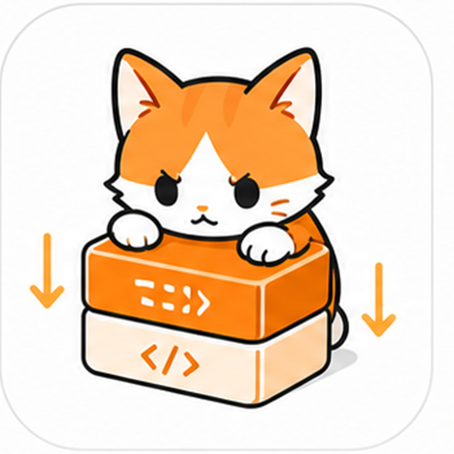

<p align="center">
  
</p>

<div align="center">
  

# d-token

**更少上下文。同样意图。完全掌控。**

一个面向 AI 编码 Agent 的本地上下文控制面。看清每一枚 token 的去向，保持路由显式，压缩冗余内容，任何配置变更都可回退。

[English](README.md) · 简体中文

[](https://github.com/37chengshan/d-token/actions/workflows/ci.yml)


</div>

---

> **公开未签名预发布，不是正式签名安装包发布。** `0.2.0-beta.1` 只有在同一 tag 的聚合发布 workflow 中同时完成 **macOS ARM64** 与 **Windows x64** 两个平台构建，并产出匹配的 SHA-256、SBOM、license、安全扫描与 provenance 证据后，才会作为 GitHub 公开预发布资产出现。该预发布仍然是未签名的：macOS 资产没有 Developer ID 签名或 notarization，Windows 资产没有 Authenticode 签名。未签名或 ad-hoc 签名的 macOS 构建可能出现系统安全警告——这属于预期行为。请核对仓库来源与已提供的哈希，不要为来自未知来源的安装包绕过系统安全保护。

## 你的 Agent 话很多，花得更多

AI 编码 Agent 会一遍又一遍重发相同的文件、日志和工具输出。token 账单在悄悄增长，但没人能说清楚：这些 token 到底花在了哪里、哪个 Provider 处理了请求、所谓的"优化"是否真的有效。

d-token 在本机运行于你的 Agent 与你选择的模型服务之间，做四件事：

1. **连接** — 在一个桌面应用里发现并接入你的编码 Agent。
2. **优化** — 在请求离开本机之前，压缩冗余上下文。
3. **路由** — 每一次请求都走一条显式、可解释的路径到达你配置的上游。
4. **观察** — 每条请求都留下一张回执：来源 Agent、路由、token、变换与恢复状态。

工作流不变，工具不变。更少的 token，更多的可见性。配置改坏了，得到的是回头路，而不是一团谜。

## 实测数据，而非承诺

2026-08-04 的一次真实 `OpenCode → d-token → upstream` 运行：

| 信号 | 数值 | 来源 |
|---|---|---|
| 单次请求物理减少的 token | **33,705** | 真实路由流（claimable = 0） |
| 持久化的已路由请求 | 89 | runtime 汇总 |
| 物理 token 总减少量 | **279,270（约 4.0%）** | runtime 汇总 |
| 已验证的配置与回退路径 | OpenCode | 同一候选验收 |

实测数字来自证据；估算数字会明确标注为估算。完整证据与发布门禁见 [`docs/product/IMPLEMENTATION_STATUS.md`](docs/product/IMPLEMENTATION_STATUS.md)。

## 适合谁使用

| 你属于… | d-token 能给你… |
|---|---|
| **重度 token 用户**，每次会话都在消耗大量上下文 | 一个地方看清请求的成本、被压缩的内容，以及哪些优化真正有效 |
| **使用 cc-switch 或多个 Provider** 的用户 | 显式、可观测的路由——绝不背着你静默切换服务商 |
| **对修改配置很谨慎**的用户 | 每一次写入都有预览、脱敏 Diff、备份、确认，以及经过验证的回退路径 |
| **刚接触 Agent 配置**的新用户 | Agent 自动发现和引导式连接流程，不再需要手改配置文件 |
| **Windows 或 macOS** 用户 | 同一套桌面应用，两个平台共享相同的信息架构 |

## 产品预览

### 1. 本地优先的控制面

在一个桌面控制面中查看 runtime 状态、受支持 Agent 的连接、Route 证据、token 测量与诊断。可用性以证据为准：不可用或部分完成的页面会如实标注，不会用示例成功数据填充。

<p align="center">
  
</p>

### 2. 显式路由，不静默切换

d-token 会为受支持链路记录已选择的 Route 与上游。Route 不可用时，要么保持 blocked，要么请你明确操作——绝不会静默回退到其它服务商。

<p align="center">
  
</p>

### 3. 可观测性与代码智能，但边界明确

查看脱敏 Event Ledger 证据、分析、诊断与受支持的代码智能状态。代码图谱属于实验性能力，需要用户明确导入并校验组件；视觉压缩坚持先预览，生产 Active 变换保持关闭。

<p align="center">
  
</p>

> 页面中的估算节省用于帮助判断策略，不等于模型服务商账单。仅预览、disabled、blocked 或 unavailable 的能力，都不等价于生产可用功能。

### 4. 每一次请求都留下一张回执

每条已路由请求都会生成一份 Optimization Receipt：请求来源 Agent、路由、变换类型、受保护内容、Local Token 与 Provider Token、恢复状态，以及跳过或失败原因。实测值与估算值从不混用。

<p align="center">
  
</p>

### 5. 安全配置：预览、备份、验证、回退

受支持的配置操作会展示用户可读摘要与脱敏 Diff，创建备份，要求确认，验证结果并保留回退证据。不受支持的操作保持 unavailable，而不是猜测写入配置。

<p align="center">
  
</p>

> OpenCode 当前拥有最强的已验证配置与回退路径。其它 Agent 与平台路径可能是 partial、disabled 或 unavailable。

## d-token 拒绝做的事

产品边界与功能本身同样重要：

- **不静默切换服务商。** 路由始终显式、可解释，并且由你掌控。
- **不伪造节省数据。** 估算会标注为估算；实测数字必须来自证据。
- **不猜测写入配置。** 如果一次变更无法预览、备份和回退，就不执行。
- **不让示例数据冒充真实状态。** unavailable、partial 与未验证的页面都会如实标注。
- **不把秘密写进普通日志。** API key、token、完整 prompt/response 不会进入日志、导出或提交。

## 快速开始

### 启动桌面应用

```bash
git clone https://github.com/37chengshan/d-token.git
cd d-token/code/apps/desktop
npm ci
npm run tauri:dev
```

`npm run tauri:dev` 会先准备本地运行组件，再启动桌面应用。单独运行前端只能预览界面，不能连接本机 Agent、服务或配置。

### 环境要求

- Node.js 24 与 npm
- Rust stable 工具链
- macOS ARM64 或 Windows x64 桌面开发环境
- macOS 需要 Xcode Command Line Tools
- Windows 需要 Tauri 与 WebView2 对应环境

### 构建本地候选

```bash
cd code/apps/desktop
npm run tauri:build
```

本地构建成功不代表安装包已经完成正式签名或具备公开分发条件。

### 当前可用状态

`0.2.0-beta.1` 只有在匹配 tag 的 GitHub 公开预发布中出现时，才算**公开未签名预发布**。它仍不是已签名、已公证的正式安装包发布。预发布目标覆盖 macOS ARM64 与 Windows x64；正式签名、公证与更广泛的平台验收仍是发布阻断项。

## 路线图

| 版本 | 重点 | 状态 |
|---|---|---|
| `0.2.0-beta.1` | 可信连接与可信压缩：Agent 自动发现、cc-switch 配置扫描、预览 → Diff → 备份 → 应用 → 验证 → 回退、Optimization Receipt、Doctor | 当前候选 |
| `v0.3` | 上下文连续性：跨 Agent Context Relay、Session Cache、Code Map/Signatures 复用、Recovery Pointer、cc-switch 跟随 / 锁定 / 观察模式 | 规划中 |
| `v0.4` | 自动化本地控制面：多 Agent 适配、低风险自动修复、项目与团队策略、可复现的真实任务证据、稳定签名、自动更新 | 规划中 |

Context Relay（v0.3）是规划中的能力，尚未实现——当前候选版本尚未实现跨 Agent 上下文复用。

<p align="center">
  
</p>

## 如实说明的边界

- 这是公开未签名预发布——没有 Developer ID 签名、没有公证、没有 Authenticode 签名。
- OpenCode 当前拥有最完整的真实连接与回退验证。Claude Code 与 Codex 已具备接入流程，但仍在进行同一候选版本的真实用户验收。
- 视觉压缩以 Shadow 预览为主，生产 Active 变换关闭；代码图谱为实验性能力，不会直接打包大型上游组件。
- 一部分 Headroom-derived 与 Agent 相关状态仍是 metadata-only、仅预览、静态兼容声明、partial、blocked 或 unavailable，不能据此宣称已完成完整 Headroom 能力迁移。
- token 减少可能来自实测数据，也可能来自当前证据下的估算；估算不能当作模型服务商账单。
- 受支持的配置写入遵循"预览 → 脱敏 Diff → 备份 → 确认 → 应用 → 验证 → 回退"。没有该事务能力的路径不应自动写入配置。

最新实现事实与发布阻断项以 [`docs/product/IMPLEMENTATION_STATUS.md`](docs/product/IMPLEMENTATION_STATUS.md) 为准。

## 隐私与本地数据

d-token 会把自身的设置、诊断信息、请求元数据和回退记录保存在本机。普通日志不会主动保存完整 prompt、完整 response、源代码正文、API key 或 Authorization 信息。

你选择的模型服务商仍会收到你主动发送给它的请求。d-token 不会把第三方模型服务自动变成本地服务，也不能替代你对服务商隐私条款的判断。

## 技术栈

Tauri 2 · React 18 · TypeScript · Vite · Rust · SQLite

## 开发与文档

- [产品契约](docs/PRD.md)
- [产品方向（v2.1）](docs/d-token_AI_product_target_spec_v2.md)
- [当前实现状态](docs/product/IMPLEMENTATION_STATUS.md)
- [总体架构](docs/ARCHITECTURE.md)
- [安全边界](docs/SECURITY_BOUNDARIES.md)
- [版本记录](CHANGELOG.md)
- [安全策略](SECURITY.md)
- [第三方声明](THIRD_PARTY_NOTICES.md)

欢迎通过 GitHub Issues 和 Pull Requests 提交问题、建议与改进。进行仓库级修改前，请先阅读 [`AGENTS.md`](AGENTS.md)。

## 许可证

项目采用 [Apache License 2.0](LICENSE)。打包或适配的第三方组件说明见 [THIRD_PARTY_NOTICES.md](THIRD_PARTY_NOTICES.md)。

---

<div align="center">
  <strong>d-token</strong><br />
  更少上下文。同样意图。完全掌控。
</div>
