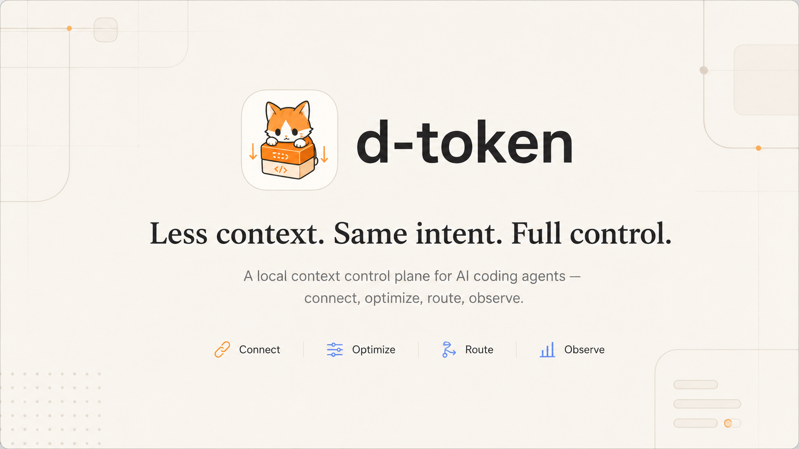
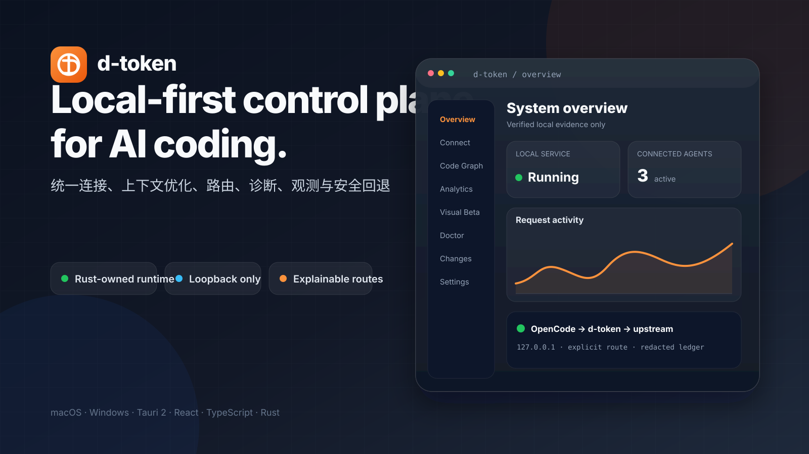
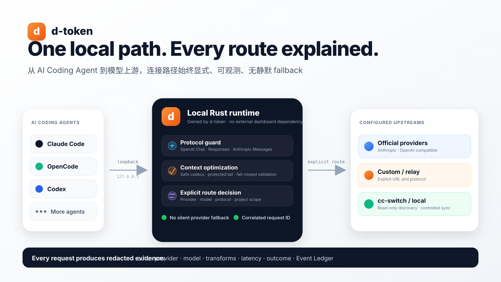
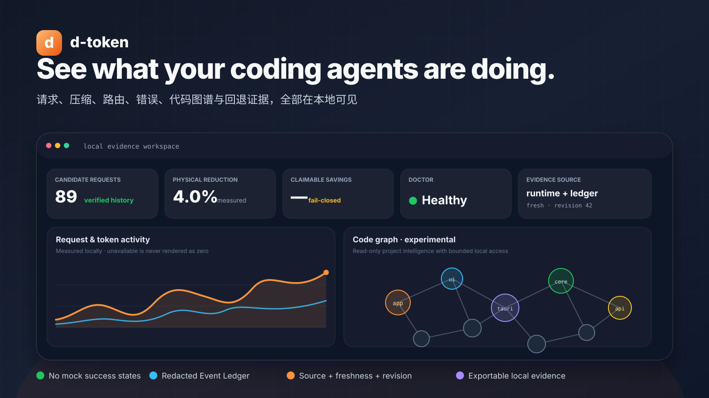
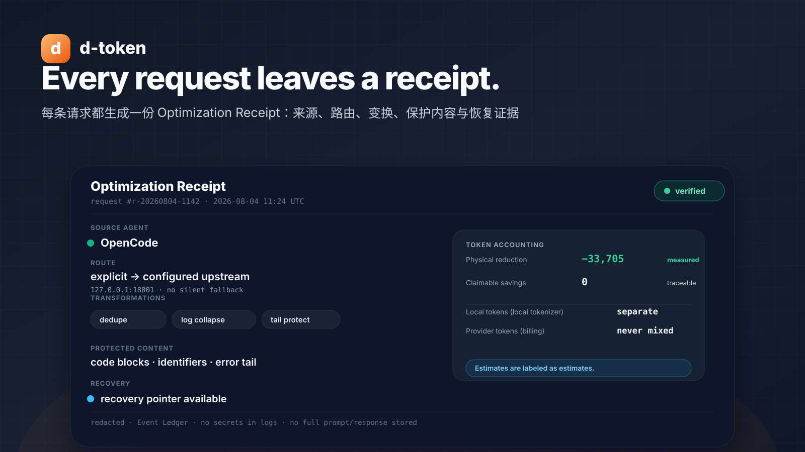
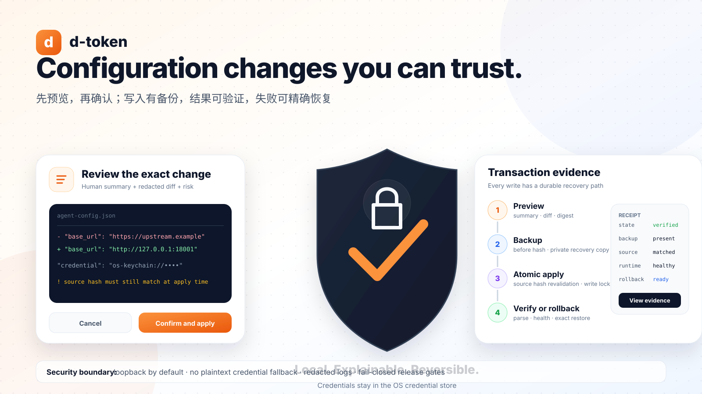
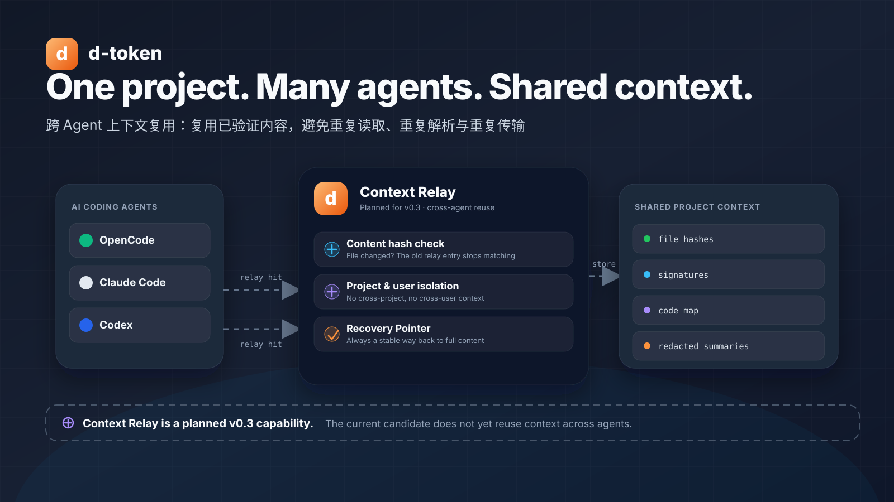

<p align="center">
  
</p>

#                                                          d-token

**Less context. Same intent. Full control.**

A local context control plane for AI coding agents — connect your agents, see where every request and every token goes, compress what's redundant, keep routing explicit, and roll back any change.

English · [简体中文](README-cn.md)

[](https://github.com/37chengshan/d-token/actions/workflows/ci.yml)


</div>

---

> **Public unsigned prerelease, not a signed installer release.** `0.2.0-beta.1` may be published as a GitHub public prerelease for **macOS ARM64** and **Windows x64** only after the tagged aggregate release workflow succeeds for both platforms in the same run and uploads the matching SHA-256, SBOM, license, security, and provenance evidence. That public prerelease is still unsigned: macOS assets are not Developer ID signed or notarized, and Windows assets are not Authenticode-signed. An unsigned or ad-hoc macOS build may trigger an operating-system security warning. Treat that warning as expected, verify the repository and supplied hashes, and do not bypass security controls for packages from untrusted sources.

## Why d-token

AI coding agents are powerful — and quiet about what they consume:

- Your agent keeps re-sending the same files, logs, and tool output, and the token bill grows without a story.
- You can rarely tell which provider or route handled a request, or whether an optimization actually helped.
- One wrong config edit can break a working setup, with no obvious way back.

d-token runs locally between your agent and the provider you chose. It shows where the tokens go, keeps the route explicit, previews optimization before it is applied, and keeps every configuration change recoverable.

The goal is simple: **use fewer tokens without turning your workflow into a pile of scripts, config files, and guesswork.**

## Who it's for

| You are… | d-token gives you… |
|---|---|
| A **heavy token user** burning context on every session | One place to see what your requests cost, what got compressed, and what actually helped |
| Running **cc-switch or multiple providers** | Explicit, observable routing — never a silent provider swap behind your back |
| **Cautious about touching config** | Every write with a preview, a redacted diff, a backup, a confirmation, and a verified rollback path |
| **New to agent configuration** | Agent auto-discovery and a guided connect flow instead of hand-editing config files |
| On **Windows or macOS** | One shared desktop app with the same information architecture on both platforms |

## Product tour

### 1. A local-first control plane for AI coding

Inspect local runtime state, supported Agent connections, route evidence, token measurements, and diagnostics in one desktop control plane. Availability is evidence-based: unavailable or partial surfaces stay labeled instead of being filled with example success data.

<p align="center">
  
</p>

### 2. Explicit routing, without silent provider switching

d-token records the selected route and upstream for supported flows. It does not silently fall back to another provider when a route is unavailable; incomplete integrations remain blocked or require explicit user action.

<p align="center">
  
</p>

### 3. Observability and code intelligence with explicit limits

Review redacted Event Ledger evidence, analytics, diagnostics, and supported code-intelligence state. Code Graph is experimental and needs an explicit verified component import. Visual Compression is preview-first; its production Active transformation remains disabled.

<p align="center">
  
</p>

> Estimated savings are guidance, not a billing statement. Metadata-only, preview-only, disabled, blocked, and unavailable capabilities are not equivalents of production-ready functionality.

### 4. Every request leaves a receipt

Each routed request produces an Optimization Receipt: source agent, route, transformations, protected content, Local vs Provider tokens, recovery status, and skip-or-failure reasons. Measured and estimated values are never mixed.

<p align="center">
  
</p>

### 5. Configure safely: review, back up, verify, and roll back

For supported configuration actions, d-token presents a user-readable summary and redacted diff, creates a backup, requires confirmation, verifies the result, and retains rollback evidence. Unsupported Agent, repair, route, or transform operations remain unavailable rather than writing guessed configuration.

<p align="center">
  
</p>

> OpenCode currently has the strongest verified configure and rollback path. Other Agent and platform paths may be partial, disabled, or unavailable.

## What d-token refuses to do

The product boundaries are as deliberate as the features:

- **No silent provider switching.** The route is always explicit, explainable, and under your control.
- **No fabricated savings.** Estimates are labeled as estimates; measured numbers come from evidence.
- **No guessed configuration writes.** If a change can't be previewed, backed up, and rolled back, it isn't made.
- **No example data posing as real status.** Unavailable, partial, and unverified surfaces are labeled as such.
- **No secrets in ordinary logs.** API keys, tokens, and full prompts/responses stay out of logs, exports, and commits.

## Measured

Real routed flows, not projections. Latest evidence from a real `OpenCode → d-token → upstream` run on 2026-08-04:

| Signal | Value | Source |
|---|---|---|
| Tokens physically reduced on a single request | 33,705 | real routed flow (claimable = 0) |
| Routed requests persisted | 89 | runtime summary |
| Total physical token reduction | 279,270 (~4.0%) | runtime summary |
| Verified configure & rollback path | OpenCode | same-candidate acceptance |

Full acceptance evidence and release gates are maintained in [`docs/product/IMPLEMENTATION_STATUS.md`](docs/product/IMPLEMENTATION_STATUS.md).

## How it fits into your workflow

```text
Your AI coding agent
        ↓
      d-token
  connect · optimize · route · observe
        ↓
Your configured model provider
```

You continue using your preferred coding agent. d-token runs locally between the agent and the provider you configured, then presents the request history, token data, route state, diagnostics, and supported recovery actions in the desktop app.

## Getting started

### Current availability

`0.2.0-beta.1` is a **public unsigned prerelease** only when it is attached to the matching GitHub prerelease tag after the same-run macOS ARM64 and Windows x64 aggregate workflow succeeds. It is still not a signed or notarized production installer release. Do not treat chat attachments, unofficial mirrors, or arbitrary unsigned local builds as official prerelease assets.

Preview target coverage is macOS ARM64 and Windows x64. macOS assets may show a security warning because the prerelease is unsigned or ad-hoc signed. Windows assets remain unsigned and do not claim Authenticode or SmartScreen reputation. Production signing, notarization, and broader platform acceptance remain release blockers.

### Requirements

- Node.js 24 and npm
- Rust stable toolchain
- macOS ARM64 or Windows x64 desktop development environment
- Xcode Command Line Tools on macOS
- Tauri and WebView2 prerequisites on Windows

### Run the desktop app

```bash
git clone https://github.com/37chengshan/d-token.git
cd d-token/code/apps/desktop
npm ci
npm run tauri:dev
```

`npm run tauri:dev` prepares the local runtime sidecar before starting the desktop app. Running the frontend by itself only previews the interface and cannot connect to local agents or services.

### Build a local candidate

```bash
cd code/apps/desktop
npm run tauri:build
```

A successful local build is not the same as an officially signed release.

## Roadmap

| Version | Focus | Status |
|---|---|---|
| `0.2.0-beta.1` | Trusted connect & trusted compression: agent discovery, cc-switch scanning, preview → diff → backup → apply → verify → rollback, Optimization Receipts, Doctor | current candidate |
| `v0.3` | Context continuity: cross-agent Context Relay, Session Cache, Code Map/Signatures reuse, Recovery Pointer, stale/superseded handling, cc-switch follow / lock / observe modes | planned |
| `v0.4` | Automated local control plane: multi-agent adaptation, low-risk auto-repair, project & team policies, reproducible real-task evidence, stable signing, auto-update | planned |

Context Relay (v0.3) is a planned capability. The current candidate does not yet reuse context across agents.

<p align="center">
  
</p>

## Beta notes

- This is a public unsigned prerelease, not a signed production release. It is not Developer ID signed, notarized, Gatekeeper-approved, or Authenticode-signed.
- OpenCode currently has the most complete verified connection and rollback flow. Claude Code and Codex integration paths exist, but full same-candidate real-user acceptance is still in progress.
- Visual Compression focuses on Shadow previews; production Active transformation remains disabled. Code Graph is experimental and does not bundle its large upstream component.
- Some Headroom-derived and Agent-facing surfaces are metadata-only, preview-only, static compatibility declarations, partial, blocked, or unavailable. They must not be read as full Headroom completion.
- Token reduction can be measured or estimated depending on available request evidence. Estimates are not provider billing data.
- Supported configuration writes follow preview → redacted diff → backup → confirmation → apply → verify → rollback. Where that transaction is not available, d-token should not write configuration automatically.

The latest implementation facts and release blockers are maintained in [`docs/product/IMPLEMENTATION_STATUS.md`](docs/product/IMPLEMENTATION_STATUS.md).

## Privacy and local data

d-token keeps its own settings, diagnostics, request metadata, and rollback records on your machine. It is designed not to store complete prompts, responses, source files, API keys, or authorization headers in ordinary logs.

Your selected model provider still receives the requests you choose to send through it. d-token does not make a third-party provider local or private by itself.

## Technology

Tauri 2 · React 18 · TypeScript · Vite · Rust · SQLite

## Development and documentation

- [Product contract](docs/PRD.md)
- [Product direction (v2.1)](docs/d-token_AI_product_target_spec_v2.md)
- [Current implementation status](docs/product/IMPLEMENTATION_STATUS.md)
- [Architecture](docs/ARCHITECTURE.md)
- [Security boundaries](docs/SECURITY_BOUNDARIES.md)
- [Changelog](CHANGELOG.md)
- [Security policy](SECURITY.md)
- [Third-party notices](THIRD_PARTY_NOTICES.md)

Contributions, bug reports, and product feedback are welcome through GitHub Issues and Pull Requests. Please read [`AGENTS.md`](AGENTS.md) before making repository-wide changes.

## License

Licensed under the [Apache License 2.0](LICENSE). See [THIRD_PARTY_NOTICES.md](THIRD_PARTY_NOTICES.md) for bundled and adapted third-party components.

---

<div align="center">
  <strong>d-token</strong><br />
  Less context. Same intent. Full control.
</div>
