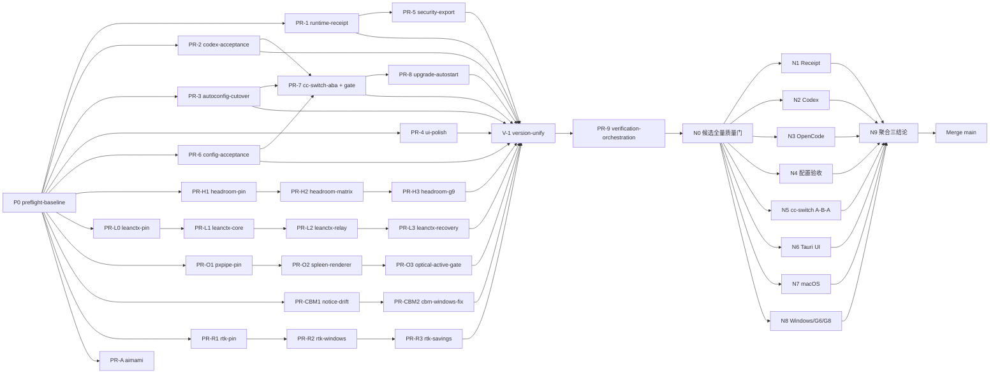

# EXECUTION — v0.0.1 执行计划（PR/worktree DAG）

- 本文件把 [REQUIREMENTS.md](./REQUIREMENTS.md) 的全部需求分解为细粒度切片。每个切片 = 独立分支 + 隔离 worktree + 独立 PR；主代理统一执行 git 生命周期并维护 `support/git-operations.json`（append-only 审计，AGENTS.md §9）。
- 切片名约定：`P0`（preflight）、`PR-N`（在途收口切片 1–9）、`V-1`（版本统一）、`PR-H*`（Headroom）、`PR-L*`（LeanCTX）、`PR-O*`（Optical/pxpipe/Spleen）、`PR-CBM*`（Codebase Memory）、`PR-R*`（RTK）、`PR-A`（AiMaMi）。
- 每个切片必须产出 `<切片名>-report.md` 到 `.ai-bridge/release-iteration/`（过程输入，不进入正式 docs）；报告模板见 §5。
- 来源：在途切片 P0/PR-1..9 由 FINAL_BLUEPRINT（`.ai-bridge/release-iteration/FINAL_BLUEPRINT.md`）映射而来；新增切片由本计划包定义。`.ai-bridge` 是过程输入，本文件不链接其路径。

## 1. 执行起点事实（2026-08-08 核对，P0 必须复核）

| 事实 | 值 |
|---|---|
| 分支 | `codex/final-release-iteration` |
| P0 freeze 时点 | `1ddb30e`（preflight-report 记录） |
| 当前工作树 HEAD | 已推进至 `51941806`（CI 稳定化提交链：16bb7ad/7ffa4fd/374368f/417ffd7/51941806…，仍在变动） |
| dirty | `support/git-operations.json`（M）；`code/crates/dtoken-compress/examples/_diag_tmp.rs`（untracked，诊断临时文件，P0 需裁决删除或忽略） |
| 版本事实 | manifest/PRD = 0.2.0-beta.1；目标 v0.0.1（VERSION-0） |
| 外部克隆 | `/Users/cc/Documents/d-token-external/`（rtk-v0.45.0、pxpipe-main-2026-08-08、lean-ctx-main-2026-08-08、spleen-2.2.0、codebase-memory-mcp-v0.9.1-rc.1、`headroom/headroom-main-2026-08-08` HEAD `7f6950be`、aimami-pinned-297c7af5 等；见 [OSS_MIGRATION.md](./OSS_MIGRATION.md)） |
| 切片独立分支 | **尚未创建**（截至 2026-08-08 不存在 P0 独立分支；§3 表内分支名均为计划名，执行时由主代理新建，不得指向/借用任何现有分支） |

P0 必须在执行开始重新核对 `git status`/`git diff`（不得假定初始干净），并在 baseline freeze 报告更新当前冻结 commit 后，所有切片以该 commit 为起点。

## 2. 通用规则（每一切片适用）

1. 只允许修改「允许文件」列；共享文件（`support/git-operations.json`、`docs/product/IMPLEMENTATION_STATUS.md`）由主代理合并期统一维护，切片不得并发改写。
2. 每个切片先过自证门再交主代理：Rust 切片 `cargo fmt --all -- --check` + `cargo clippy --workspace --all-targets -- -D warnings` + `cargo test -p <crate>`；TS 切片 `npx tsc --noEmit` + 相关 Vitest；support 切片契约测试。未运行不得声称通过。
3. Git lifecycle 归主代理：branch create/switch/commit/rebase/push/merge 前先 `python3 support/scripts/git_operation_audit.py record ...`。
4. 主代理审查门（每 PR 必查）：diff 越界？隐式依赖未声明？secret/绝对路径/raw prompt 泄漏？unavailable 变 0/绿色？Local/Provider Token 混淆？测试覆盖原失败路径与回退？引入 chooser/静默 fallback？伪造或复用过期证据？发布结论绑定同一候选 commit？任一不合格返工，不合并。
5. 禁止 `sed`/shell 重定向改源码；禁止复制外部代码不记 NOTICE/license/commit；禁止在 release build 注册 test-only commands；禁止用 mtime/latest/pass-only 接受旧证据。
6. `support/artifacts/` 只存 gitignored 运行时 evidence；可版本化 schema/template 必须放 tracked test/fixture 路径。
7. 每个切片报告含：改动文件清单、逐项验收证据、失败路径测试、证据绑定（commit/source digest/schema version）、隐私/安全自检、未验证声明、回滚方式、下游依赖。

## 3. 切片定义

### 3.1 在途切片（P0, PR-1..9）

| 切片 | 分支/worktree | 允许文件 | 禁止项 | 测试 | DoD | 回滚 | 依赖 |
|---|---|---|---|---|---|---|---|
| P0 preflight-baseline | `codex/final/preflight-baseline` | `support/git-operations.json`（仅审计记录）；`.ai-bridge/release-iteration/preflight-report.md` | 改任何 `code/`、docs；跑 formatter/lint/tests/build；push/merge | 不跑测试 | 核对 git status/diff main.rs；无未提交改动被覆盖；baseline freeze 报告落盘（冻结 commit、worktree 哈希、审计账本条目） | 无（只读） | — |
| PR-1 runtime-receipt | `codex/final/runtime-receipt` | `code/crates/dtoken-types/src/lib.rs`、`code/crates/dtoken-types/tests/`、`code/crates/dtoken-core-api/src/lib.rs`、`code/crates/dtoken-core-api/tests/` | 改前端/docs；复制整份 accounting 进 receipt；改变既有字段含义 | `cargo test -p dtoken-types -p dtoken-core-api` + clippy + fmt | OptimizationReceipt 类型 + RequestLog provider usage 字段（serde 兼容）+ 投影；claimable 规则单测；脱敏断言 | `git revert <commit>` | P0 |
| PR-2 codex-ocxlocal-acceptance | `codex/final/codex-ocxlocal-acceptance` | `support/scripts/run_codex_ocxlocal_routed_acceptance.py`（新）、`support/tests/test_codex_ocxlocal_acceptance.py`（新）、`support/fixtures/codex-ocxlocal-routed/` | 写真实 Codex 配置；读/打印 auth/密钥/完整 prompt；改 workflows | 契约测试 + `--check-schema` 离线校验 | 链路 18001→10100→动态 model、agent_id=codex、隐私断言；artifact schema tracked | 删脚本/测试（revert） | P0 |
| PR-3 autoconfig-cutover | `codex/final/autoconfig-cutover` | `code/apps/desktop/src/app/lib/connectionSetup.tsx`、`installMachine.ts`、`install/presentation.tsx`、`components/pages/Install.tsx`、`Onboarding.tsx` 及相关测试、`code/crates/dtoken-config-patcher/src/cc_switch.rs` + 测试、`code/apps/desktop/src-tauri/src/upstream_discovery.rs` + 测试、`docs/d-token_AI_product_target_spec_v2.md`、`docs/PLAN.md`（仅 chooser/skip 旧口径文字同步） | 新增任何 chooser；改八页 IA/shell；改 PRD | Vitest 全量 + `tsc --noEmit` + grep 无残留断言 | 生产无 `needs-choice`/`selection_required`；`needs-source-fix`/`has_resolution_gap` 全链路；cc-switch 未知 schema blocked；spec v2.1 F-01 等旧口径同步 | revert + ConfigPatcher 恢复 | P0 |
| PR-4 ui-polish | `codex/final/ui-polish` | Topbar/Overview/StatusBar/Heatmap/Changes/DoctorWorkbench/nav.ts/Sidebar/i18n.ts/CodebaseMemory（仅文案）及对应 `.test.tsx`、e2e/desktop-control-plane.spec.ts、e2e/pages/app-shell.page.ts、styles/shell.css（仅 whitespace） | 改 Analytics 日志高度/布局；新建页面；改 IA/动画/配色；删 sr-only H1 或唯一可见标题 | Vitest 相关 + `tsc --noEmit` + build + Playwright E2E（920×640 `scrollWidth<=clientWidth`、Reduce Motion） | audit C1–C8 逐条核对表；Analytics diff=0；badge 双语可访问 | revert | P0 |
| PR-5 security-classifier-export | `codex/final/security-classifier-export` | `code/apps/desktop/src-tauri/src/main.rs`、`src-tauri/Cargo.toml`、`code/crates/dtoken-compress/src/optical/secret.rs`、`code/crates/dtoken-core-api/src/lib.rs`（export payload）、相关测试 | 改前端；fork 复制 SecretClassifier；导出字段改无证据枚举 | Rust clippy/fmt/test；classifier 覆盖矩阵 + export 绝对路径 fixture 回归 | 全部 production secret validation path 复用共享 classifier；export 无绝对 config path；回归先红后绿 | revert | P0 + PR-1 |
| PR-6 config-acceptance | `codex/final/config-acceptance` | `support/scripts/run_agent_config_acceptance.py`（新）、`support/tests/test_agent_config_acceptance.py`（新）、`support/fixtures/` | 写真实 Agent 配置；读 auth；改产品代码/workflows | 契约测试（隔离根、hash/权限证据、无 auth 读取、逆序回退） | 副本上 configure→reread→clear→exact restore；原文件仅 hash/权限证据；整批失败逆序回退 | 删 harness（revert） | P0 |
| PR-7 cc-switch-aba-evidence + gate wiring | `codex/final/cc-switch-aba-evidence` | `support/scripts/run_cc_switch_aba_check.py`（新）、`support/tests/test_cc_switch_aba_check.py`（新）、`support/scripts/generate_release_gate_status.py`、`support/tests/test_release_gate_status_aggregation.py`、`.github/workflows/public-unsigned-prerelease.yml`、`macos-release.yml`、`windows-release.yml`（仅证据接线） | 实现 Agent 操控真实 UI 做 A→B→A；写 cc-switch 数据库；把聚合改成非 fail-closed；改写 G0–G8 语义 | 契约测试：artifact schema、wrote_cc_switch=false、route identity 相同；聚合扩展（缺失/旧 commit/digest mismatch → blocked）；G7 仍只代表 Real OpenCode | artifact + 聚合扩展 | revert | P0 + PR-2/3/6 |
| PR-8 upgrade-autostart-credential | `codex/final/upgrade-autostart-credential` | `support/scripts/run_macos_upgrade_rollback_audit.py`（新）、`support/scripts/run_autostart_credential_roundtrip.py`（新）、`support/tests/test_upgrade_autostart_credential.py`（新） | 改产品代码；声称 Windows 实机/签名凭据通过；破坏真实凭据库 | dry-run 契约 + 故障注入（创建后验证失败/删除恢复失败/已有同名状态） | macOS upgrade→rollback 审计报告；LaunchAgent/HKCU、Keychain/Credential Manager 唯一隔离 round-trip；cleanup/exact-restore 失败 → ok=false | 隔离 entry 删除 | P0 + PR-7 |
| PR-9 verification-orchestration | `codex/final/verification-orchestration` | `support/scripts/run_final_candidate_verification.py`（新）、`support/tests/test_final_candidate_verification.py`（新）、`support/scripts/run_tauri_ui_acceptance.py` 或记录模板（新）、`.ai-bridge/release-iteration/final-candidate-evidence.md`（模板） | 改任何业务代码；伪造截图/证据；把旧 G7/旧 DMG/browser preview 写入最终证据；改 G0–G8 语义 | `--dry-run`（DAG 无环、N0 先于 N1–N8、N9 最后、候选变化失效）；旧 pass artifact 拒绝 fixture | N0→N1–N8→N9 编排 + 三结论判定表 | 删编排脚本（revert） | P0 + PR-1..8 |

### 3.2 新增切片（本计划包定义）

| 切片 | 分支/worktree | 允许文件 | 禁止项 | 测试 | DoD | 回滚 | 依赖 |
|---|---|---|---|---|---|---|---|
| V-1 version-unify | `codex/final/version-unify` | `code/apps/desktop/src-tauri/tauri.conf.json`、`code/apps/desktop/package.json`、`code/apps/desktop/src-tauri/Cargo.toml`（如含版本）、`support/scripts/check_release_version.py`、`docs/PRD.md`（P0.0 版本门文字）、`docs/PLAN.md`、`docs/product/IMPLEMENTATION_STATUS.md`、`CHANGELOG.md`、`docs/index.md`、release workflow 的 tag/版本引用 | 改业务代码逻辑；把 0.2.0-beta.1 从 history/archive 抹除；未经用户确认执行 | `python3 support/scripts/check_release_version.py`、`python3 support/scripts/check_structure.py`；全仓活跃文档 grep 无 0.2.0-beta.1（除历史） | 用户确认后全仓版本单源化 = v0.0.1；manifest/PRD/workflow/docs 一致；版本检查通过。`docs/PLAN.md` 与 `docs/product/IMPLEMENTATION_STATUS.md` 的版本修改由主代理合并期统一执行（V-1 切片不并发改写）；目标版本仍需用户确认 | revert + 版本还原 | **全部功能切片**（PR-1..8、PR-H3、PR-L3、PR-O3、PR-CBM2、PR-R3，含 PR-7 的 workflow 接线；避免 workflow 重叠），先于 PR-9/N0 |
| PR-H1 headroom-pin | `codex/final/headroom-pin` | `code/runtimes/headroom/README.md`、`docs/legal/THIRD_PARTY_NOTICES.md`、`THIRD_PARTY_NOTICES.md`（根）、本包 OSS_MIGRATION.md（同步） | 改代码；把 v0.34.0 / main 未评估写完成 | 无（文档切片，结构检查 + 漂移 grep） | 唯一 pin；评估记录；漂移 D2 闭合 | revert | P0 |
| PR-H2 headroom-matrix | `codex/final/headroom-matrix` | 对应 `code/crates/` 与测试、`docs/PLAN.md` §1C 矩阵执行事实列 | 用前端显示掩盖后端缺口；改 PRD | 相关 crate 全量测试 + clippy/fmt | 矩阵零占位/缺失或显式记录 + 用户裁决；G0–G5 项证据绑定候选 | revert | PR-H1, PR-1 |
| PR-H3 headroom-g9 | `codex/final/headroom-g9` | `support/scripts/`（证据脚本）、`docs/PLAN.md` §1C.2、本包 VERIFICATION.md（同步） | 在 G0–G8 未全绿时声称 G9 通过 | 契约测试 | G9 判定表落盘；§8 逐项绑定 `C_final` | revert | PR-H2, PR-7, PR-9 |
| PR-L0 leanctx-pin | `codex/final/leanctx-pin` | `code/runtimes/headroom/README.md`（LeanCTX 节）、`docs/legal/THIRD_PARTY_NOTICES.md`、根 NOTICE | 改代码 | 文档切片 + 漂移 grep | pin 唯一；main `95a1b7bc` vs v3.9.17 评估记录；漂移 D4 闭合 | revert | P0 |
| PR-L1 leanctx-core | `codex/final/leanctx-core` | 新增 `code/crates/dtoken-context-bus/`（或并入 dtoken-context-store 的切片文件）、对应测试 | 把 Relay 命中计为压缩收益；secret/未脱敏原文进 cache | `cargo test -p <crate>` + clippy/fmt | Context Bus + Session Cache + 自命中防护实现与测试 | revert | PR-L0 |
| PR-L2 leanctx-relay | `codex/final/leanctx-relay` | 对应 crate/测试 | 收益双计 | 同上 | Relay + Query-aware Retrieval + 收益分离计量测试 | revert | PR-L1 |
| PR-L3 leanctx-recovery | `codex/final/leanctx-recovery` | 对应 crate/测试 | 用旧 cache 继续回答 | 同上 | Recovery Pointer + Stale/Superseded + SharedContext 实现与测试 | revert | PR-L2 |
| PR-O1 pxpipe-pin | `codex/final/pxpipe-pin` | `docs/legal/THIRD_PARTY_NOTICES.md`（pxpipe/Spleen 节）、`docs/optical/`（实现状态/评测文档）、本包 OSS_MIGRATION.md（同步） | 复制 pxpipe 代码进生产；把参考轨写成迁移完成 | 文档切片 + capability matrix 复核脚本（如已有 V3 harness 则跑评测） | v0.12.0/`0ceabbe` 评估记录；旧 pin 标注历史；漂移 D3 闭合 | revert | P0 |
| PR-O2 spleen-renderer | `codex/final/spleen-renderer` | `code/crates/dtoken-compress/src/optical/`（renderer 相关）、`docs/legal/THIRD_PARTY_NOTICES.md`、相关测试 | 改产品行为语义外的无关文件 | `cargo test -p dtoken-compress` + 确定性测试 | Spleen 2.2.0 声明完整；跨平台渲染确定性测试通过 | revert | PR-O1 |
| PR-O3 optical-active-gate | `codex/final/optical-active-gate` | `code/crates/dtoken-compress/src/optical/`（gate/feature）、相关测试、`docs/optical/release-gates.md` | 开启 production active；提供 UI 开关 | `cargo test -p dtoken-compress` | active 不可达断言；shadow raw ingress 测试；门槛文档落盘 | revert | PR-O2, PR-1 |
| PR-CBM1 cbm-notice-drift | `codex/final/cbm-notice-drift` | 根 `THIRD_PARTY_NOTICES.md`（CBM 条目）、`docs/legal/THIRD_PARTY_NOTICES.md`（如含 CBM 条目）、`code/runtimes/codebase-memory/README.md`（如需要） | 改 manifest 哈希/放宽校验 | 结构检查 + pin 唯一 grep | D1 漂移闭合；v0.9.0 标 superseded | revert | P0 |
| PR-CBM2 cbm-windows-fix | `codex/final/cbm-windows-fix` | `code/runtimes/codebase-memory/`（launcher/校验）、`code/apps/desktop/src/app/components/pages/CodebaseMemory.tsx`（仅 Bug 相关）、`support/scripts/prepare_codebase_memory_artifact.py`、`support/tests/`、`docs/product/IMPLEMENTATION_STATUS.md`（合并期由主代理） | 放宽校验；读用户源码/凭据；删除用户文件 | Rust/TS 相关测试 + Windows runner 证据脚本 | v0.9.0 Bug：失败测试先红后绿 + 临时 Agent 配置 preview/apply/verify/rollback + 原始 hash/权限恢复；Windows archive/binary SHA + Cosign 校验落证；状态五维不冒充 | revert + 配置恢复 | PR-CBM1, PR-6 |
| PR-R1 rtk-pin | `codex/final/rtk-pin` | `docs/legal/THIRD_PARTY_NOTICES.md`、根 NOTICE、`code/runtimes/`（managed-rtk 登记位置）、本包 OSS_MIGRATION.md（同步） | 把 RTK 写成独立产品路径 | 文档切片 + pin grep | v0.45.0/`b34be37` pin 登记；许可证/NOTICE 核验；漂移 D5 闭合 | revert | P0 |
| PR-R2 rtk-windows | `codex/final/rtk-windows` | `support/scripts/run_wsl_rtk_integrity_test.ps1`、`support/tests/`、`support/artifacts/`（运行时） | 改产品代码；冒充 Windows 实机证据 | 契约测试 + runner 证据 | Windows/WSL managed lifecycle + hook integrity 证据；缺失则 external/blocked | revert | PR-R1 |
| PR-R3 rtk-savings | `codex/final/rtk-savings` | 对应 runtime/metrics crate 与测试、`docs/PLAN.md`（§10 分账节文字，如需要） | 双计 | `cargo test` 相关 crate | 分账契约测试；无 `rtk_savings+runtime_savings` 路径 | revert | PR-R2 |
| PR-A aimami-provenance | `codex/final/aimami-provenance` | `docs/legal/THIRD_PARTY_NOTICES.md`（AiMaMi 节）、派生文件源码注释（如注释与声明不一致时） | 引入 AiMaMi 品牌资产 | 文档切片 + 适配表 grep | 适配范围表与实际派生文件一致；LICENSE 副本哈希复核 | revert | P0 |

> 说明：PR-H1/L0/O1/CBM1/R1/A 均为文档/provenance 切片，无代码依赖，可并行；PR-H2/L1..L3/O2/O3/CBM2/R2/R3 为代码切片，按依赖串行。所有新增切片与在途 PR-1..9 无文件重叠（已按 §4 分区）。

## 4. 依赖 DAG 与波次

| 波次 | 并行切片 | 完成条件 | 出口门 |
|---|---|---|---|
| W0 | P0 | baseline freeze 报告（冻结 commit 更新到当前 HEAD 事实） | 主代理确认 |
| W1 | PR-1, PR-2, PR-3, PR-4, PR-6（在途）+ PR-H1, PR-L0, PR-O1, PR-CBM1, PR-R1, PR-A（新增文档切片，互不重叠） | 各自自证门 + 报告 | 逐个主代理审查 |
| W2 | PR-5（依赖 PR-1）；PR-7（依赖 PR-2/3/6）；PR-H2；PR-L1；PR-O2；PR-CBM2；PR-R2 | 各自自证 + 报告 | 逐个主代理审查 |
| W3 | PR-8（依赖 PR-7）；PR-H3；PR-L2；PR-O3；PR-R3 | 自证 + 报告 | 逐个主代理审查 |
| W4 | PR-L3；V-1（依赖全部功能切片 + PR-7，先于 PR-9）；PR-9（依赖全部切片合并） | V-1 版本检查通过；PR-9 dry-run + DAG 校验 | 主代理审查 |
| W5 | N0 完整候选质量门 | 全部通过；修复产生新 commit 后完整重跑 N0 | 主代理确认当前 commit 完整证据 |
| W6 | N1–N8 并行真实验证 | 每域证据绑定同一 `C_final`；Windows/G6/G8 缺失则 external/blocked | 主代理逐域核对 |
| W7 | N9 聚合 + 结论判定 + Merge main | N1–N8 全部结算，输出三结论之一 | 主代理最终签核 |

## 5. 文件重叠与串行化（强制）

- `code/crates/dtoken-types/src/lib.rs`、`code/crates/dtoken-core-api/src/lib.rs`：仅 PR-1 → PR-5 串行；PR-O3/PR-R3 不得触碰。
- `support/scripts/generate_release_gate_status.py`、`support/tests/test_release_gate_status_aggregation.py`、`.github/workflows/*`：仅 PR-7 接线；V-1 改 workflow 版本引用必须在 PR-7 合并后。
- desktop 前端：PR-3（安装状态 + `upstream_discovery.rs`）、PR-4（shell/pages/nav/sidebar/i18n）、PR-CBM2（仅 CodebaseMemory Bug 相关）三分区，禁止交叉修改。
- `docs/PLAN.md`：PR-3（1A.6 文案）、PR-H2/H3（1C 矩阵/G9）、PR-R3（§10 文字）、V-1（版本事实）按顺序串行；正式状态列由主代理合并期统一维护。
- 根 NOTICE / `docs/legal/THIRD_PARTY_NOTICES.md`：PR-H1、PR-L0、PR-O1、PR-CBM1、PR-R1、PR-A 必须按依赖串行（每个切片合并后再合下一个），或合并为一个 provenance 批次由主代理统一执行——默认按六个独立切片串行，避免并发写同一文档。
- `support/git-operations.json`、`docs/product/IMPLEMENTATION_STATUS.md`：主代理合并期统一维护。

## 6. 严格合并顺序（主代理执行）

1. W0 P0 冻结基线 → W1 并行切片逐个审查合并。
2. W2：PR-5（PR-1 后）、PR-7（PR-2/3/6 后）与各 provenance/功能切片按依赖串行；串行触碰共享文件。
3. W3：PR-8（PR-7 后）与 PR-H3/PR-L2/PR-O3/PR-R3。
4. W4：PR-L3 → V-1（用户确认版本）→ PR-9（全部合并后 dry-run 校验 DAG）。
5. W5：N0 完整候选质量门；失败修复产生新 commit 必须完整重跑 N0。
6. W6：N1–N8 并行真实验证；OpenCode 最终候选重跑；Windows/G6/G8 缺失标 external/blocked。
7. W7：N1–N8 全部结算后 N9 聚合，判定三结论之一并落盘发布报告；技术预览保持 `distribution_ready_public=false`、`release_ready=false`。

## 7. 回滚与 Plan Mutation

- 代码回滚：单切片 `git revert <commit>`（先 `git_operation_audit.py record`）；配置回滚：ConfigPatcher 既有 backup/restore；凭据：隔离 entry 删除；cc-switch：只读未写无需回滚。
- 执行 Agent 不得自行改写本文件的切片边界/依赖/结论判定；变更由主代理在 `.ai-bridge/release-iteration/<date>-mutation.md` 记录并同步本文件；本文件随执行滚动更新（切片状态推进由 [TASKS.md](./TASKS.md) 承担，本文件只改结构事实）。
- 任一切片返工超过 2 轮仍失败：停止该切片，主代理重新评估方案，不得靠扩大容错掩盖。

## 8. 与 requirement 的映射

- V-1 → VERSION-0/VERSION-1/DOCS-4；PR-1 → PRODUCT-1/RUNTIME-1/RUNTIME-4；PR-2 → AGENT-1/RUNTIME-6；PR-3 → AGENT-3/AGENT-5/SECURITY-7；PR-4 → UI-1/2/3/5/7；PR-5 → SECURITY-1/2/3；PR-6 → AGENT-6/CONFIG-1/2/3；PR-7 → AGENT-5/EVID-1/3/6/PLATFORM-3；PR-8 → PLATFORM-1/2/CONFIG-4；PR-9 → EVID-2/DOCS-3/PLATFORM-4；PR-H* → CONTEXT-1/2/OSS-1；PR-L* → CONTEXT-1/3；PR-O* → OPTICAL-2/3/4/5/6/OSS-1；PR-CBM* → PRODUCT-6/OSS-1/4；PR-R* → RUNTIME-5/PLATFORM-5/OSS-1；PR-A → OSS-1/2。全量映射见 [REQUIREMENTS.md](./REQUIREMENTS.md) owner 列。
