# EXECUTION — v0.0.1 执行计划（PR/worktree DAG）

- 本文件把 [REQUIREMENTS.md](./REQUIREMENTS.md) 的全部需求分解为细粒度切片。每个切片 = 独立分支 + 隔离 worktree + 独立 PR；主代理统一执行 git 生命周期并维护 `support/git-operations.json`（append-only 审计，AGENTS.md §9）。
- 切片名约定：`P0`（preflight）、`PR-N`（在途收口切片 1–9）、`V-1`（版本统一）、`PR-H*`（Headroom）、`PR-L*`（LeanCTX）、`PR-O*`（Optical/pxpipe/Spleen）、`PR-CBM*`（Codebase Memory）、`PR-R*`（RTK）、`PR-A`（AiMaMi）。
- 每个切片必须产出 `<切片名>-report.md` 到 `.ai-bridge/release-iteration/`（过程输入，不进入正式 docs）；报告模板见 §5。
- 来源：在途切片 P0/PR-1..9 由 FINAL_BLUEPRINT（`.ai-bridge/release-iteration/FINAL_BLUEPRINT.md`）映射而来；新增切片由本计划包定义。`.ai-bridge` 是过程输入，本文件不链接其路径。

## 1. 执行起点事实（P0 运行时采集并冻结；历史 commit 仅作过程事实）

> **基线口径（2026-08-09 修订）**：本计划不再硬编码任何历史 HEAD 作为执行基线（统一压缩审计 §0：计划写 `51941806`、preflight 记 `1ddb30e`、FINAL_BLUEPRINT 记 `f0a9bed`，实测工作树 HEAD 已推进至 `dc647af`——多版本口径均已过时）。所有基线事实由 **P0 在执行时点用 `git status`/`git rev-parse HEAD` 实时采集并冻结**，写入 `.ai-bridge/release-iteration/preflight-report.md` 更新版；历史 commit 只作过程事实记录，不得作为切片起点。

| 事实 | 值（历史过程事实，非执行基线） |
|---|---|
| 分支 | `codex/final-release-iteration`（2026-08-09 实测 HEAD `dc647af`；preflight 曾记 `1ddb30e`、FINAL_BLUEPRINT 曾记 `f0a9bed`、旧计划曾写 `51941806`） |
| 执行基线 | **无硬编码**——由 P0 执行时 `git rev-parse HEAD` 采集、干净后冻结为 `C_final` 前置基线；此前所有 HEAD 数字仅历史 |
| dirty（2026-08-09 实测） | `support/git-operations.json`（M）；`code/crates/dtoken-compress/examples/_diag_tmp.rs`（untracked，诊断临时文件，P0 需裁决删除或忽略）；9 个 release 文档 M（本计划包修订中） |
| 版本事实 | manifest/PRD = 0.2.0-beta.1；目标 v0.0.1（VERSION-0） |
| 外部克隆 | `/Users/cc/Documents/d-token-external/`（rtk-v0.45.0、pxpipe-main-2026-08-08、lean-ctx-main-2026-08-08、spleen-2.2.0、codebase-memory-mcp-v0.9.1-rc.1、`headroom/headroom-main-2026-08-08` HEAD `7f6950be`、aimami-pinned-297c7af5 等；见 [OSS_MIGRATION.md](./OSS_MIGRATION.md)） |
| 切片独立分支 | **尚未创建**（截至 2026-08-09 无 P0 独立分支；§3 表内分支名均为计划名，执行时由主代理新建，不得指向/借用任何现有分支） |

P0 必须在执行开始重新核对 `git status`/`git diff`（不得假定初始干净），并在 baseline freeze 报告更新当前冻结 commit 后，所有切片以该 commit 为起点。

## 2. 通用规则（每一切片适用）

1. 只允许修改「允许文件」列；共享文件（`support/git-operations.json`、`docs/product/IMPLEMENTATION_STATUS.md`）由主代理合并期统一维护，切片不得并发改写。
2. 每个切片先过自证门再交主代理：Rust 切片 `cargo fmt --all -- --check` + `cargo clippy --workspace --all-targets -- -D warnings` + `cargo test -p <crate>`；TS 切片 `npx tsc --noEmit` + 相关 Vitest；support 切片契约测试。未运行不得声称通过。
3. Git lifecycle 归主代理：branch create/switch/commit/rebase/push/merge 前先 `python3 support/scripts/git_operation_audit.py record ...`。
4. 主代理审查门（每 PR 必查）：diff 越界？隐式依赖未声明？secret/绝对路径/raw prompt 泄漏？unavailable 变 0/绿色？Local/Provider Token 混淆？测试覆盖原失败路径与回退？引入 chooser/静默 fallback？伪造或复用过期证据？发布结论绑定同一候选 commit？任一不合格返工，不合并。
5. 禁止 `sed`/shell 重定向改源码；禁止复制外部代码不记 NOTICE/license/commit；禁止在 release build 注册 test-only commands；禁止用 mtime/latest/pass-only 接受旧证据。
6. `support/artifacts/` 只存 gitignored 运行时 evidence；可版本化 schema/template 必须放 tracked test/fixture 路径。
7. 每个切片报告含：改动文件清单、逐项验收证据、失败路径测试、证据绑定（commit/source digest/schema version）、隐私/安全自检、未验证声明、回滚方式、下游依赖。

## 3. 切片定义

### 3.1 在途切片（P0, PR-1..9）

| 切片 | 分支/worktree | 允许文件 | 禁止项 | 测试 | DoD | 回滚 | 依赖 |
|---|---|---|---|---|---|---|---|
| P0 preflight-baseline | `codex/final/preflight-baseline` | `support/git-operations.json`（仅审计记录）；`.ai-bridge/release-iteration/preflight-report.md` | 改任何 `code/`、docs；跑 formatter/lint/tests/build；push/merge | 不跑测试 | 核对 git status/diff main.rs；无未提交改动被覆盖；baseline freeze 报告落盘（冻结 commit、worktree 哈希、审计账本条目） | 无（只读） | — |
| PR-1 runtime-receipt | `codex/final/runtime-receipt` | `code/crates/dtoken-types/src/lib.rs`、`code/crates/dtoken-types/tests/`、`code/crates/dtoken-core-api/src/lib.rs`、`code/crates/dtoken-core-api/tests/` | 改前端/docs；复制整份 accounting 进 receipt；改变既有字段含义 | `cargo test -p dtoken-types -p dtoken-core-api` + clippy + fmt | OptimizationReceipt 类型 + RequestLog provider usage 字段（serde 兼容）+ 投影；claimable 规则单测；脱敏断言 | `git revert <commit>` | P0 |
| PR-2 codex-ocxlocal-acceptance | `codex/final/codex-ocxlocal-acceptance` | `support/scripts/run_codex_ocxlocal_routed_acceptance.py`（新）、`support/tests/test_codex_ocxlocal_acceptance.py`（新）、`support/fixtures/codex-ocxlocal-routed/` | 写真实 Codex 配置；读/打印 auth/密钥/完整 prompt；改 workflows | 契约测试 + `--check-schema` 离线校验 | 链路 18001→10100→动态 model、agent_id=codex、隐私断言；artifact schema tracked | 删脚本/测试（revert） | P0 |
| PR-3 autoconfig-cutover | `codex/final/autoconfig-cutover` | `code/apps/desktop/src/app/lib/connectionSetup.tsx`、`installMachine.ts`、`install/presentation.tsx`、`components/pages/Install.tsx`、`Onboarding.tsx` 及相关测试、`code/crates/dtoken-config-patcher/src/cc_switch.rs` + 测试、`code/apps/desktop/src-tauri/src/upstream_discovery.rs` + 测试、`docs/d-token_AI_product_target_spec_v2.md`、`docs/PLAN.md`（仅 chooser/skip 旧口径文字同步） | 新增任何 chooser；改八页 IA/shell；改 PRD | Vitest 全量 + `tsc --noEmit` + grep 无残留断言 | 生产无 `needs-choice`/`selection_required`；`needs-source-fix`/`has_resolution_gap` 全链路；cc-switch 未知 schema blocked；spec v2.1 F-01 等旧口径同步 | revert + ConfigPatcher 恢复 | P0 |
| PR-4 ui-polish | `codex/final/ui-polish` | Topbar/Overview/StatusBar/Heatmap/Changes/DoctorWorkbench/nav.ts/Sidebar/i18n.ts/CodebaseMemory（仅文案）及对应 `.test.tsx`、e2e/desktop-control-plane.spec.ts、e2e/pages/app-shell.page.ts、styles/shell.css（仅 whitespace） | 改 Analytics 日志高度/布局；新建页面；改 IA/动画/配色；删 sr-only H1 或唯一可见标题 | Vitest 相关 + `tsc --noEmit` + build + Playwright E2E（920×640 `scrollWidth<=clientWidth`、Reduce Motion） | audit C1–C8 逐条核对表；Analytics diff=0；badge 双语可访问 | revert | P0 |
| PR-5 security-classifier-export | `codex/final/security-classifier-export` | `code/apps/desktop/src-tauri/src/main.rs`、`src-tauri/Cargo.toml`、`code/crates/dtoken-compress/src/optical/secret.rs`、`code/crates/dtoken-core-api/src/lib.rs`（export payload）、相关测试 | 改前端；fork 复制 SecretClassifier；导出字段改无证据枚举 | Rust clippy/fmt/test；classifier 覆盖矩阵 + export 绝对路径 fixture 回归 | 全部 production secret validation path 复用共享 classifier；export 无绝对 config path；回归先红后绿 | revert | P0 + PR-1 |
| PR-6 config-acceptance | `codex/final/config-acceptance` | `support/scripts/run_agent_config_acceptance.py`（新）、`support/tests/test_agent_config_acceptance.py`（新）、`support/fixtures/` | 写真实 Agent 配置；读 auth；改产品代码/workflows | 契约测试（隔离根、hash/权限证据、无 auth 读取、逆序回退） | 副本上 configure→reread→clear→exact restore；原文件仅 hash/权限证据；整批失败逆序回退 | 删 harness（revert） | P0 |
| PR-7 cc-switch-aba-evidence + gate wiring | `codex/final/cc-switch-aba-evidence` | `support/scripts/run_cc_switch_aba_check.py`（新）、`support/tests/test_cc_switch_aba_check.py`（新）、`support/scripts/generate_release_gate_status.py`、`support/tests/test_release_gate_status_aggregation.py`、`.github/workflows/public-unsigned-prerelease.yml`、`macos-release.yml`、`windows-release.yml`（仅证据接线） | 实现 Agent 操控真实 UI 做 A→B→A；写 cc-switch 数据库；把聚合改成非 fail-closed；改写 G0–G8 语义 | 契约测试：artifact schema、wrote_cc_switch=false、route identity 相同；聚合扩展（缺失/旧 commit/digest mismatch → blocked）；G7 仍只代表 Real OpenCode | artifact + 聚合扩展 | revert | P0 + PR-2/3/6 |
| PR-8 upgrade-autostart-credential | `codex/final/upgrade-autostart-credential` | `support/scripts/run_macos_upgrade_rollback_audit.py`（新）、`support/scripts/run_autostart_credential_roundtrip.py`（新）、`support/tests/test_upgrade_autostart_credential.py`（新） | 改产品代码；声称 Windows 实机/签名凭据通过；破坏真实凭据库 | dry-run 契约 + 故障注入（创建后验证失败/删除恢复失败/已有同名状态） | macOS upgrade→rollback 审计报告；LaunchAgent/HKCU、Keychain/Credential Manager 唯一隔离 round-trip；cleanup/exact-restore 失败 → ok=false | 隔离 entry 删除 | P0 + PR-7 |
| PR-9 verification-orchestration | `codex/final/verification-orchestration` | `support/scripts/run_final_candidate_verification.py`（新）、`support/tests/test_final_candidate_verification.py`（新）、`support/scripts/run_tauri_ui_acceptance.py` 或记录模板（新）、`.ai-bridge/release-iteration/final-candidate-evidence.md`（模板） | 改任何业务代码；伪造截图/证据；把旧 G7/旧 DMG/browser preview 写入最终证据；改 G0–G8 语义 | `--dry-run`（DAG 无环、N0 先于 N1–N8/N10、N9 最后、候选变化失效）；旧 pass artifact 拒绝 fixture | N0→N1–N8/N10→N9 编排 + 三结论判定表 | 删编排脚本（revert） | P0 + PR-1..14 + PR-CBM3/4 + C0–C8（最终 DAG 唯一口径） |
| PR-10 codex-toml-top-level | `codex/final/codex-toml-top-level` | `code/apps/desktop/src-tauri/src/upstream_discovery.rs`（`candidate_from_codex_toml` 增顶层 `openai_base_url`/`model_catalog_json` 解析）、相关测试、`support/fixtures/codex-toml/`（新：顶层 base_url+model_catalog_json 与 `[model_providers]` 两种形态 fixture） | 写真实 Codex 配置；读 auth；改 PRD | Rust clippy/fmt/test + fixture 单测 | 两种 Codex 形态都产生上游候选；顶层解析 fixture 覆盖；不读 auth；无 chooser | revert | P0 |
| PR-11 cc-switch-openclaw | `codex/final/cc-switch-openclaw` | `code/apps/desktop/src-tauri/src/upstream_discovery.rs`（discovery SQL/`agent_ids_for_cc_switch_app` 补 openclaw）、`code/crates/dtoken-config-patcher/src/cc_switch.rs` + 测试、`support/fixtures/cc-switch/`（openclaw app type fixture）、`code/crates/dtoken-config-patcher/src/cc_switch.rs`（`cc_switch_sync_state` 补 enriched 状态/`route_snapshot_identity`，H4 下沉） | 写 cc-switch DB；改产品 UI；改 PRD | Rust clippy/fmt/test + fixture 单测 | openclaw app type A→B→A 连续识别可见；`wrote_cc_switch=false`；未知 schema blocked；cc-switch sync 与 active route 最终比对（`derive_cc_switch_status`/`enrich_upstream_discovery`）为 Rust-owned 合同，desktop 与 Rust 输出一致单测，`route_snapshot_identity`/`last_receipt` 非空（H4） | revert | P0, PR-3 |
| PR-12 native-responses-single-dispatch | `codex/final/native-responses-single-dispatch` | `code/crates/dtoken-core-api/src/lib.rs`（Native Responses handler 经 `prepare_json_pipeline_payload`）、`code/crates/dtoken-types/`（Responses wire 适配）、相关 parity fixture/tests | 绕过 pipeline 的独立 Responses 路径残留；改 UI | Rust clippy/fmt/test + HTTP parity fixture | `/v1/responses` 经 canonical pipeline；decision/reason/artifact parity 与 Chat 同 fixture 字节一致；发送体=验证体 | revert | PR-C1C, PR-1 |
| PR-13 hot-sync-auth-revocation | `codex/final/hot-sync-auth-revocation` | `support/scripts/run_hot_sync_review_gate_evidence.py`（新，只读观察 watcher→review_required→plan/confirm/apply 闭环）、`support/tests/`、授权设计记录（PRD 先行）、`support/scripts/run_bridge_identity_check.py`（新，只读 bridge component/protocol/OS/arch/version + 签名/Team ID/Authenticode 验证，H3） | 在 PRD 授权前实现 `automatic_apply_allowed=true` 自动写；破坏 review 门；读 auth | 契约测试 + 只读观察 harness | 证据证明热同步 review-gated 存在（`automatic_apply_allowed=false`，无自动写路径）；PRD 授权范围与撤销语义先行；dtoken-agent-bridge 身份验证通过后才开放 MCP/Hook desktop-managed 写面（H3），本机 6 Agent managed 写面真实 preview→apply→verify→rollback | 删 harness（revert） | P0, PR-3 |
| PR-14 onboarding-5seg | `codex/final/onboarding-5seg` | `code/apps/desktop/src/app/components/pages/Onboarding.tsx`（STEP_KEYS 收敛 5 段、删独立 upstream、service 动画 + 顺序门）、`code/apps/desktop/src/app/components/common/StepProgress.tsx`（接入）、`code/apps/desktop/src/app/lib/onboarding.ts`、`src-tauri/src/main.rs`（install-progress stage 事件或轮询里程碑）、`code/apps/desktop/src/app/lib/i18n.ts` + 各页 DICT 迁移（onb.*/八页文案）、`copyPolicy.test.ts`（组件内 zh/en 字面量断言）、`code/apps/desktop/src/app/components/pages/Install.tsx`（仅 `window.confirm`→统一 OperationDialog，M-3）、相关 `.test.tsx` | 新增一级页/改 IA/改 shell；删 sr-only H1；改 Analytics 日志高度；把 upstream 变成 chooser | Vitest 相关 + `tsc --noEmit` + copyPolicy 断言 + E2E 顺序门 | STEP_KEYS=5（welcome/service/agents/config/verify）；独立 upstream 步骤删除；service 阶段标签+indeterminate 动画+Reduce Motion 静态等价；顺序门（未启动服务不能进 config）；组件内无 zh/en 字面量逃逸；service 运行中≠connected 文案诚实（H-1：service healthy 徽标不得误读为已连接，成功文案「服务已启动，尚未完成 Agent 接入」）；Install 写操作确认统一走 OperationDialog（M-3） | revert | P0 |

### 3.2 新增切片（本计划包定义）

| 切片 | 分支/worktree | 允许文件 | 禁止项 | 测试 | DoD | 回滚 | 依赖 |
|---|---|---|---|---|---|---|---|
| V-1 version-unify | `codex/final/version-unify` | manifest、release scripts/workflows、`docs/PRD.md` 版本门、PLAN/status/CHANGELOG/index | 改业务逻辑；删除历史版本记录 | release-version + structure + active-doc grep | 全部功能切片合并后一次性统一为 v0.0.1；用户已指定，无需再次确认 | revert + 版本还原 | PR-C8C、PR-1..14、PR-CBM2/3/4、PR-A |
| PR-C0A schemas-policy | `codex/final/c0-schemas-policy` | `dtoken-types`（新模块优先）、`dtoken-router`、合同测试 | 改现有业务行为；引入 engine chooser | compile/serde/enum invariant tests | 冻结 `BoundRequest/IrNode/NodeAction/NodePlan/StageArtifact/OptimizationManifest`、全局 safety policy、四维 accounting、decision digest | revert | P0, PR-H1/L0/R1/O1 |
| PR-C0B sealed-receipts | `codex/final/c0-sealed-receipts` | `dtoken-runtime-pipeline`、`dtoken-types` receipt 模块、compile-fail tests | adapter 可构造 Optimized/Committed；只校验 `ccr:`/时间戳 | crate + compile-fail + forged-receipt negatives | artifact-derived ValidationReceipt、强 RecoveryReceipt、transport-observable SendCommitReceipt；constructor crate-private/sealed | revert | PR-C0A |
| PR-C0C registry-corpus | `codex/final/c0-registry-corpus` | `support/fixtures/unified-capability-registry-v1.json`、benchmark/replay corpus manifest、validator + tests | 手写完成百分比；placeholder/not-in-scope | Python contract tests | 117 项唯一机器 registry；固定 corpus/digest/schema；每项 owner/dispatch/test/evidence/gate 非空 | revert | PR-H1/L0/R1/O1, PR-C0A |
| PR-C0D registry-117-start | `codex/final/c0-registry-117-start` | **与 PR-H2 合并为一个切片**（统一压缩审计建议 3）：117 registry 框架+内容同 PR，用「9 codec 真实项（`production_registry_codec_ids`）+ 12 聚合 ID 映射」起步，再逐领域扩充到 117；C2 等所有 codec 切片以 registry 条目为 DoD（unified-compression 审计：117 项清单无任何机器工件，support 工具仅 12 聚合 ID + 9 codec registry） | 先写 codec 实现再补 registry；只登记不接 dispatch | registry validator + coverage 契约测试 | registry 每项 `id/source_capability/owner_crate/dispatch_symbol/tests/real_evidence/gates/status` 必填；9 codec 真实项先行映射；status 只允许 implemented_unverified/verified/blocked | revert | PR-C0C |
| PR-C1A route-lowering | `codex/final/c1-route-lowering` | `dtoken-router`、`dtoken-compress` IR/lowering、protocol tests | 从 body/preview 自报 route/capability；多次 lowering | route + IR fixture tests | RouteDecision 唯一权威；三协议 parse/lower 一次；保护 flags/zone/source digest 稳定 | revert | PR-C0A/B |
| PR-C1B reuse-before-plan | `codex/final/c1-reuse-before-plan` | `dtoken-core-api` memory path、`dtoken-compress` planner、tests | post-validation body mutation | digest/parity tests | 删除 `inject_memory_into_body` 后注入；Reuse 在 transform 前入 IR；final send digest=validated digest | revert | PR-C1A, PR-C3A |
| PR-C1C single-dispatch | `codex/final/c1-single-dispatch` | `dtoken-runtime-pipeline`、core-api/proxy/MCP/SDK adapters、compress entry、tests | 保留 no-op/第二 compression engine；adapter 自有 policy | surface parity + lifecycle + compile-fail | HTTP/Rust/MCP/TS/Proxy 全部调用同一 resolved pipeline；删 production no-op/fallback 双路径 | revert | PR-C0B, PR-C1A/B, PR-1 |
| PR-C2A headroom-codecs | `codex/final/c2-headroom-codecs` | `dtoken-compress` registry/router/codecs/manifest、property/fuzz tests | 动态插件/外部 runtime；递归任意 JSON string | codec property/fuzz/reconstruction | JSON/log/search/build/diff/text/HTML/config/code 与 mixed routing 全部 exclusive NodeAction；protected/exact/negative fail-closed | revert | PR-C1C, PR-H2 |
| PR-C2B cache-live-zone | `codex/final/c2-cache-live-zone` | compress context pipeline、provider-cache contract/tests | cache 自报稳定；跨 identity 复用 | cache/frozen-prefix tests | live-zone/stable-prefix/cache key/TTL/strategy exact identity；stale/mismatch miss | revert | PR-C2A |
| PR-C2C ccr-memory-learning | `codex/final/c2-ccr-memory-learning` | context-store/runtime-pipeline/learning/MCP tests | raw CCR 进 ordinary store；未授权 scan/share | lifecycle/crash/tool/retrieve tests | CCR tool/retrieve/crash、memory/SharedContext、learning/output/holdout 残余 117 项闭合 | revert | PR-C0B, PR-C1C, PR-H2 |
| PR-C3A context-bus-core | `codex/final/c3-context-bus-core` | 新 `dtoken-context-bus` + workspace、从 compress/store **搬移** policy、tests | 复制第二套策略；存 raw/secret | crate tests | Context Bus、Session Cache、map/signature、self-hit/scope/size state machine；store 仅 persistence port | revert | PR-L0, PR-C0A |
| PR-C3B relay-retrieval | `codex/final/c3-relay-retrieval` | context-bus + runtime integration/tests | Relay 算 compression savings | two-Agent/cross-project tests | Context Relay、query-aware retrieval、RelayHit/CacheReuse receipts；污染=0、自命中=0 | revert | PR-C3A, PR-C1C |
| PR-C3C recovery-shared | `codex/final/c3-recovery-shared` | context-bus + store ports + pipeline/tests | stale/best-effort hit | stale/permission/crash tests | Recovery Pointer/Manifest、Stale/Superseded、SharedContext grant/revoke；变化即 miss | revert | PR-C3B, PR-C2C |
| PR-C4A rtk-filters | `codex/final/c4-rtk-filters` | `dtoken-preprocessor` classifier/TOML DSL/filters + fuzz tests | 执行命令；处理 ordinary prompt | class/reconstruction/negative/fuzz | git/cargo/npm/pytest/json 结构化过滤；unknown/secret/error/negative 保留 | revert | PR-R1, PR-C0A, **PR-C4U（解封前置）** |
| PR-C4U rtk-unblock | `codex/final/c4-rtk-unblock` | `dtoken-preprocessor` managed_rtk lifecycle（移除三平台 `ManagedRtkTransactionState::Blocked` 硬封锁 → 「未配置即 unavailable」语义）+ 测试改写（`managed_rtk_lifecycle_is_explicitly_blocked_on_macos_and_windows` 先红后绿）+ identity/ACL 校验不弱化 | 解封前宣称完成；绕过 PID/identity/ACL 校验 | 生命周期单测先红后绿 + 三平台未配置=unavailable 断言 | 三平台 managed 操作不再 Blocked；未配置=unavailable；安全校验不弱化；**RUNTIME-10 是 C4A/B/C 前置阻断** | revert | PR-R1, PR-C0A |
| PR-C4B rtk-hook-tee | `codex/final/c4-rtk-hook-tee` | preprocessor、agent-bridge/config-patcher、platform support/tests | 记录 argv/raw output/credential；外部 standalone 路径 | lifecycle/fault/permission tests | 至少一真实支持 Agent hook 指向 bridge；tee private TTL/ACL；exit/timeout/truncation；macOS/Windows/WSL | revert | PR-C4A, PR-6 |
| PR-C4C rtk-planner-accounting | `codex/final/c4-rtk-planner-accounting` | compress planner/runtime/Ledger/projections/tests | RTK 再进 Headroom/Optical；收益相加 | exclusive-action/double-count tests | RtkCommandOutput production dispatch、四维 bucket、卸载/cleanup；无双计 | revert | PR-C4B, PR-C1C |
| PR-C5A optical-renderer | `codex/final/c5-optical-renderer` | optical renderer/font/profile/provenance + cross-platform fixtures | 普通图片入口；复制 pxpipe runtime | deterministic/self-decode/resource tests | pxpipe/Spleen pin 单一；Unicode/CJK fallback；macOS/Windows PNG digest 一致；资源硬限 | revert | PR-O1/O2, PR-C0C |
| PR-C5B optical-history-cache | `codex/final/c5-history-cache` | optical inventory/IR/cache tests | current/recent/open/exact 入图 | frozen-prefix/cache-anchor tests | history collapse/static slab/freeze grid/cache anchor/billing boundary/pin 语义；protected text 不变 | revert | PR-C5A, PR-C2B |
| PR-C5C optical-attestation | `codex/final/c5-attestation` | capability/economics/eval registry + tests | wildcard/LocalEstimate 授权 active | signature/lifecycle/economics negatives | exact route/provider/model/API + renderer/font/profile/corpus/tokenizer/pricing/cache digest；过期/revoked 拒绝 | revert | PR-C5B, PR-C7B |
| PR-C5D optical-active | `codex/final/c5-optical-active` | planner/engine/typed patcher/post-validator/send integration/tests | UI active 开关；unsupported protocol active；codec fallback chain | E2E + pre/post-commit fault tests | 至少一个 exact Anthropic route 自动 active；其余 PreserveText；artifact-derived validation；无 UI chooser | revert | PR-C5C, PR-C6C |
| PR-C6A concurrency-ledger | `codex/final/c6-concurrency-ledger` | pipeline/ledger bounded workers/queues/tests | 无界 task/queue；hot path FS/network/process | contention/cancel/deadline tests | 有界并发、稳定输出序、request-wide deadline/byte permit；队列饱和 Preserve | revert | PR-C2/C3/C4/C5A |
| PR-C6B durability-faults | `codex/final/c6-durability-faults` | context-store/ledger failpoints、support fault registry/tests | silent best-effort before send | crash/restart/fault matrix | CCR FULL durability；projection 可重建；跨 JSONL/SQLite/private store 唯一安全终态 | revert | PR-C6A, PR-C2C |
| PR-C6C recovery-state-machine | `codex/final/c6-recovery-state-machine` | runtime-pipeline/core-api/proxy/stream tests | post-commit retry/provider switch | fault/fuzz/replay | pre-commit candidate failure只发送 baseline 一次；post-commit 永不自动 retry；每请求唯一终态 | revert | PR-C0B, PR-C6B |
| PR-C7A perf-baseline | `codex/final/c7-perf-baseline` | benchmark corpus/criterion-like runner/alloc-RSS instrumentation/tests | 用 no-op path/UI timing；先写任意阈值 | runner contract tests | resolved path fresh baseline：p50/p95/p99/CPU/throughput/alloc/RSS/queue/cancel/benefit/fallback；冻结 noise/no-regression band；**另采集 product-level corpus 端到端节省 baseline（QUALITY-8 floor ≥10% 门槛基准，与 no-regression band 分离）** | revert | PR-C1C, PR-C6C, PR-C0C |
| PR-C7B replay-quality-eval | `codex/final/c7-quality-eval` | replay/paired eval/task corpus/holdout + schemas/tests | 第三方 benchmark 冒充 actual；只跑 happy path | deterministic replay + offline contract | coding-task baseline/optimized same-model paired outcome；Optical fidelity/cost/latency；malformed/resource/stale holdout | revert | PR-C7A（按 §4 唯一 DAG：C1C/C6C/C0C→C7A→C7B；不回指 C7B 的已完成 stage artifacts 经 C7A 消费，字面不展开 C2..C6 以免含 C5B/C6 回指环；C5C 依赖 PR-C7B 保持） |
| PR-C7C optimization-SLO | `codex/final/c7-slo` | hot-path parse/clone/measure + thresholds/runner | 牺牲正确性换速度；重复整树 clone | benchmark + quality gate | parse/digest/token once、lazy candidate/Cow；提升超噪声且全质量门绿；C_final thresholds 固化 | revert | PR-C7A/B |
| PR-C8A capability-proof | `codex/final/c8-capability-proof` | registry generator/validator、capability projection、gate tests | 手写 pass；mtime/latest | 117 coverage contract | 117/117 registry→dispatch→test→real evidence→gate；任一缺失 blocked | revert | PR-H2, PR-C2..C7 |
| PR-C8B real-routes-platform | `codex/final/c8-real-routes` | support acceptance schemas/workflows；运行 evidence gitignored | 旧 artifact；真实配置越权 | schema/dry-run + authorized N2/N3/N8 | Provider/Agent matrix、OpenCode/Codex、Optical exact route、macOS/Windows 同 commit evidence | revert + exact config restore | PR-C8A, PR-2/6/7/8 |
| PR-C8C final-gate-wiring | `codex/final/c8-final-gate` | release gate aggregator/orchestrator/tests/EVIDENCE templates | 降级任何 MUST；旧证据穿透 | candidate mismatch/fault fixtures | C_final/source_digest/corpus/registry/eval/platform 强绑定；N10 作为 G8/G9 required evidence | revert | PR-C8B, PR-9 |
| PR-CBM1/2 | 保持 [OSS_MIGRATION.md](./OSS_MIGRATION.md) 定义 | CBM provenance/launcher/config bug 范围 | 放宽 hash/签名校验 | 原计划测试 | v0.9.1-rc.1 供应链 + v0.9.0 配置 Bug 完整闭环 | revert/配置恢复 | P0, PR-6 |
| PR-CBM3 | CBM 多版本 manifest schema v2（五正式版 v0.9.0/v0.8.1/0.8.0/0.7.0/0.6.1 + 批准 prerelease pin v0.9.1-rc.1 并列标注）；逐版本 tag/commit/平台 archive+binary SHA/协议适配器/平台矩阵（v0.8.1 无 windows-arm64 → incompatible）；版本身份只用 tag/commit/hash（不读 server.json version）；构建期 v2 manifest 摘要 + 完整性测试；promo 生成（`generate-promo-v2.mjs`）由 v2 manifest 驱动（M1） | `code/runtimes/codebase-memory/artifact-manifest.json`（v2 schema）、`code/crates/dtoken-codebase-memory/src/lib.rs`（ARTIFACT_SPECS 版本化）、`code/apps/desktop/src-tauri/src/codebase_memory_control.rs`（UPSTREAM_RELEASE_URL/status_revision 版本化）、`code/apps/desktop/scripts/generate-promo-v2.mjs`（改读 v2 manifest，M1）、相关测试 | 放宽校验/伪造验证/删除既有 pin | manifest 契约测试 + 构建期摘要测试 | 五正式版 + 批准 prerelease pin 全可寻址；UI 标注 pre-release；promo 无硬编码版本字面量；任一版本无资产/无证据 → 该版本 incompatible/blocked，release 保持 blocked | revert | P0, PR-CBM1 |
| PR-CBM4 | 逐版本真实验证 harness：v0.9.0/v0.8.1（有官方二进制）临时工程 indexing/graph query/call chain/dependency/impact 真实验证落证；0.8.0/0.7.0/0.6.1（官方无资产）source-tag 登记 + fail-closed（untrusted/incompatible），UI 不开放运行时能力 | `support/scripts/run_cbm_version_acceptance.py`（新）、`support/tests/test_cbm_version_acceptance.py`（新）、`support/fixtures/cbm-versions/`（新） | 伪装无资产版本通过；repo zero-write 越界；persistence 非 false | 契约测试（zero-write/endpoint allowlist/persistence=false）+ 有资产版本真实执行 | 有官方二进制版本逐版本真实通过；无资产版本 fail-closed 呈现；绝不冒充 runtime 兼容；缺上游资产 → blocked | 删 harness（revert） | PR-CBM3, PR-6 |
| PR-A | 保持 AiMaMi provenance 复核 | legal/source comments | 引入品牌资产 | structure/license | pin/LICENSE/适配边界一致 | revert | provenance batch |

> PR-H/L/R/O 是 provenance、矩阵和差异追踪层；生产实现一律落在 PR-C0..C8 的唯一 crate owner 中，禁止再建立第二套 pipeline。共享合同/producer 先合，消费者后合。

## 4. 依赖 DAG 与波次

```mermaid
flowchart LR
  P0 --> PROV[PR-H1/L0/R1/O1/O2/CBM1/A provenance]
  P0 --> BASE[PR-1..14 功能切片 + PR-CBM3/4]
  PROV --> C0A[PR-C0A schemas]
  C0A --> C0B[PR-C0B receipts] & C0C[PR-C0C registry/corpus]
  C0C --> C0D[PR-C0D 117-start（与 H2 合并）]
  C0B & C0C --> C1A[PR-C1A route/lowering]
  C1A --> C3A[PR-C3A context-bus core]
  C3A --> C1B[PR-C1B reuse-before-plan]
  C1B --> C1C[PR-C1C single dispatch]
  C1C --> C2A[PR-C2A codecs] & C3B[PR-C3B relay] & C4U[PR-C4U RTK unblock] & C5A[PR-C5A renderer]
  C0D --> C2A
  C4U --> C4A[PR-C4A RTK filters]
  C2A --> C2B[PR-C2B cache/live-zone] --> C2C[PR-C2C CCR/memory/learning]
  C3B --> C3C[PR-C3C recovery/shared]
  C4A --> C4B[PR-C4B hook/tee] --> C4C[PR-C4C planner/accounting]
  C2B & C5A --> C5B[PR-C5B Optical history/cache]
  C2C & C3C & C4C & C5B --> C6A[PR-C6A concurrency/ledger]
  C6A --> C6B[PR-C6B durability/faults] --> C6C[PR-C6C recovery state]
  C1C & C6C --> C7A[PR-C7A perf baseline]
  C7A --> C7B[PR-C7B replay/quality/paired eval] --> C7C[PR-C7C optimize/SLO]
  C5B & C7B --> C5C[PR-C5C attestation/economics] --> C5D[PR-C5D exact active]
  C2C & C3C & C4C & C5D & C6C & C7C --> C8A[PR-C8A 117 proof]
  BASE & C8A --> C8B[PR-C8B real routes/platform]
  C8B --> V1[V-1 version unify] --> PR9[PR-9 orchestration] --> C8C[PR-C8C gate wiring]
  C8C --> N0[N0 freeze/preflight]
  N0 --> N1 & N2 & N3 & N4 & N5 & N6 & N7 & N8 & N10
  N1 & N2 & N3 & N4 & N5 & N6 & N7 & N8 & N10 --> N9[N9 final aggregation]
```

| 波次 | 可并行切片 | 出口门 |
|---|---|---|
| W0 | P0 | 工作树/现有修改/基线 commit 冻结 |
| W1 | provenance 研究（代码只读，可并行）+ 原 PR-1/2/3/4/6 | 每条 provenance 单一 pin；共享 NOTICE 合并由主代理串行 |
| W2 | PR-C0A；PR-CBM2；PR-5/7/8（各自依赖满足后） | schema review；无 owner/ID 漂移 |
| W3 | PR-C0B 与 PR-C0C（在 C0A 后可并行） | sealed receipt compile-fail；117 registry/corpus 校验 |
| W4 | PR-C1A → PR-C1B → PR-C1C | single production pipeline 与 surface parity |
| W5 | PR-C2、PR-C3、PR-C4、PR-C5A 内部按各链串行，四轨道彼此并行 | 每 stage production dispatch；共享 planner 接口只由 C1 定义 |
| W6 | PR-C5B + PR-C6A/B/C | exclusive actions、durability/fault graph、唯一 fallback 终态 |
| W7 | PR-C7A→C7B→C7C；完成后 PR-C5C→C5D | baseline 后才冻结 SLO；paired eval 后才 active |
| W8 | PR-C8A→C8B | 117/117 proof + real route/platform evidence |
| W9 | V-1→PR-9→PR-C8C | v0.0.1 单版本；完整 verification DAG/gate wiring |
| W10 | N0，然后 N1–N8/N10 并行，再 N9 | 同一 C_final/source_digest；任一缺失 blocked |

## 5. 文件重叠与串行化（强制）

- `dtoken-types`：PR-C0A → PR-C0B → PR-1（必要适配）；之后只允许新增独立模块，不并行改同一声明。
- `dtoken-runtime-pipeline`：PR-C0B → PR-C1C → PR-C6A/B/C；这是 ReadyToSend/commit/fallback 唯一 owner。
- `dtoken-core-api/src/lib.rs`：PR-1/PR-5 完成后，PR-C1B → PR-C1C；后续 stage 只能经 pipeline API 接入，不再直接加 policy。
- `dtoken-compress` planner/IR：PR-C1A/B/C → PR-C2 → PR-C5B/D；renderer 独立文件 PR-C5A 可与 C2 并行，最终由 C5B/D 集成。
- `dtoken-context-store`：PR-C2C → PR-C3C → PR-C6B；`dtoken-context-bus` domain 不得把 persistence 复制回来。
- `dtoken-preprocessor`：PR-C4A → PR-C4B；planner/accounting 接线由 PR-C4C 修改 compress/runtime，不与 C1/C6 并发。
- capability registry/corpus/gates：PR-C0C → PR-C8A → PR-C8C；任何其他切片只能消费，不得手改 status。
- 根 NOTICE/legal notices：所有 provenance 调研可并行，最终文档写入合并为一个主代理 provenance commit，避免六分支冲突。
- `docs/PLAN.md`、`docs/product/IMPLEMENTATION_STATUS.md`、本计划包、`support/git-operations.json` 由主代理在每波次边界统一同步。

## 6. 严格合并顺序

1. 冻结 P0；并行完成 provenance 调研与原收口切片，主代理串行合并共享 NOTICE。
2. 合并 C0 schema，再并行 C0B/C0C；任何 consumer 不得先于 schema。
3. C1 clean cutover 完成后，才并行 C2/C3/C4/C5 的独立 stage 内核。
4. C6 统一并发/持久化/恢复；C7 先 baseline、再质量/paired eval、最后优化/SLO。
5. Optical capability/economics 在 C7B 后；C5D active 在 C5C 与 C6C 后。
6. C8A 必须读取所有 stage 的 production dispatch；C8B 才执行真实 Agent/provider/platform evidence。
7. V-1、PR-9、C8C 最后串行；冻结 C_final 后执行 N0，再并行 N1–N8/N10，N9 最终聚合。

## 7. 回滚与 Plan Mutation

- 每切片只 revert 自己的 commit；配置/凭据/cc-switch 按既有 exact restore 合同。任何 schema revert 必须同时 revert 尚未合并的消费者。
- 修复产生新 commit 时，从第一个受影响验证节点起所有 artifact 失效；若影响 source digest、registry、corpus、route、renderer 或 eval，则 N0–N10 全部重跑。
- 执行 Agent 不得把 MUST 改为 boundary/deferred/not-in-scope；计划结构变更只由主代理同步本包与 Living Plan。

## 8. Requirement 映射

- C0：PRODUCT-8、RUNTIME-7/8/9、QUALITY-1/3/7；C1：RUNTIME-7/8、CONTEXT-4、QUALITY-6；C2：Headroom 117 core、CONTEXT-2、QUALITY-2；C3：CONTEXT-1/3/4；C4：RUNTIME-5/7/9、PLATFORM-5；C5：OPTICAL-1..6；C6：CONTEXT-2、QUALITY-2/5/7；C7：QUALITY-3/4/6；C8：QUALITY-1、EVID-1/2/3/6、PLATFORM-3/4。其余原切片映射保持 [REQUIREMENTS.md](./REQUIREMENTS.md) owner 列为准。
