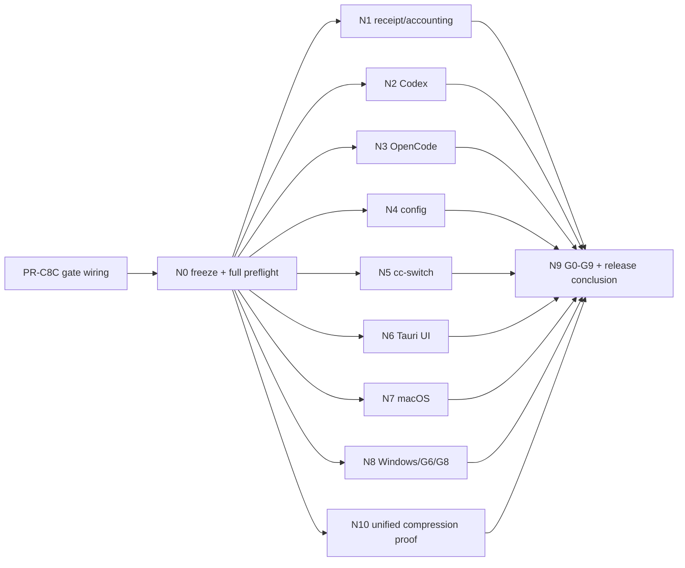

# VERIFICATION — v0.0.1 验证与发布门

- 规则：**证据只对精确候选 commit 有效**。最终候选 `C_final` 冻结后，任何机器消费的证据必须匹配 `C_final` + 同一 `source_digest`；修复产生新 commit 后旧证据全部失效，必须重跑 N0 并重做受影响节点。
- 聚合器：`support/scripts/generate_release_gate_status.py`（fail-closed：任一 gate 非 passed 即 exit 1；`--report-only` 仅供诊断）；PR-7 扩展 candidate binding 与 supplemental evidence，PR-9 负责 DAG 编排。
- 过期证据隔离清单见 [EVIDENCE.md](./EVIDENCE.md#2-过期证据隔离清单)。

## 1. 证据公共 envelope（所有 N0–N10 必填）

每个机器 artifact 顶层必须包含：`schema_version`、`node_id`、`status`、`reason_codes[]`、`candidate_commit`、`source_digest`、`dirty=false`、`registry_digest`、`corpus_digests{}`、`started_at`、`finished_at`、`platform{os,arch,toolchain}`、`producer_revision`、`artifact_sha256`。Optical/benchmark/paired eval 还必须包含对应 `route_decision_digest`、`capability_digest`、`renderer/profile/font/tokenizer/pricing/cache/eval` digests；不适用字段显式为 `null` 并给 reason，不能省略后被当作通过。

`source_digest` 由 tracked source manifest 计算：按 UTF-8 path 排序，对每个 tracked 文件记录 SHA-256，canonical JSON 序列化后再 SHA-256；gitignored artifact、target/node_modules/build 输出不进入。`dirty=true`、commit/digest 缺失或任一 artifact 与期望不匹配，聚合立即 blocked。

## 2. Verification DAG

修复规则：任何代码/配置/schema/registry/corpus/threshold/route/capability/eval 变更产生新 commit 后，旧 artifact 失效。若只影响单个平台打包 metadata，可重跑 N0 + 该平台 + N9；若影响 source digest、pipeline、registry、corpus、route、renderer、accounting、recovery 或 eval，N0–N10 全重跑。

## 3. N0 — 冻结候选与全量前置门

1. 工作树 clean；冻结 `C_final`、source manifest/digest、117 registry digest、各 corpus/threshold schema digest。
2. `python3 support/scripts/check_structure.py` 与版本门（v0.0.1 单一事实源）。
3. Rust：fmt、Clippy `-D warnings`、workspace tests；前端：Vitest、`tsc --noEmit`、build、Chromium/WebKit E2E。
4. no-touch fixture/fake-bin/poison-bin、临时 HOME/PATH/端口；release build 无 benchmark/smoke/test-only command。
5. security/privacy：SecretClassifier 统一、无 secret/raw prompt/response/PNG/base64/绝对 config path ordinary persistence；loopback-only；进程停止 identity；cc-switch read-only；无 Agent/Provider/model/engine chooser。
6. OSS：全部 pin 唯一、NOTICE/SBOM/license/provenance 随包；无外部 Headroom/LeanCTX/RTK/pxpipe runtime dependency。
7. 117 registry validator 先通过结构门；此时允许 `implemented_unverified`，但 N9 前必须由 N10/C8 proof 变为 117/117 `verified`。

输出：`support/artifacts/final-candidate/<C_final>/N0-preflight.json`。任一失败不得运行会产生真实外部副作用的 N2/N3/N5/N7/N8/N10 provider lane。

## 4. N1–N8 真实产品/平台节点

| 节点 | 覆盖 | 通过标准 | 当前计划事实 |
|---|---|---|---|
| N1 Receipt/accounting | PRODUCT-1..4、RUNTIME-1/2/5/9、CONTEXT-2/3/4 | 真实 routed 请求逐 request id 对账；Local estimate/Provider actual/claimable 分离；compression/command-output/cache/Relay 四 bucket 独立；发送 digest=validation digest；Analytics/Overview/export 无双计、unknown≠0、无敏感原文 | PR-1/C1/C3/C4/C8 后执行 |
| N2 Codex | AGENT-1/8、RUNTIME-6 | `Codex→d-token:18001/v1→ocxlocal:10100/v1→动态 model`；Responses 协议、无 OpenAI auth 语义；**两种 Codex 配置形态（顶层 `openai_base_url`+`model_catalog_json` 与 `[model_providers]`）均解析为上游候选（PR-10 fixture 单测）**；artifact 含 agent/provider/model/protocol/route verified/匹配数/Ledger/metrics/失败/恢复/隐私断言 | 不得由配置恢复替代 |
| N3 OpenCode | AGENT-2、QUALITY-4 | **两条长工程验收**：OpenCode Free（`opencode/deepseek-v4-flash-free`）与 Go dsv4flash 工程链，各自在 `C_final` 上执行真实 routed path、长时/长上下文工程 workload、same-model baseline/optimized paired outcome、C_final/source digest 绑定、原始配置字节/hash/权限精确恢复；旧 bounded replay（2026-08-04 G7）与 31 份既有 routed 证据只作历史，不替代 | 旧 G7 只作历史；必须 C_final 重跑；bounded replay 不替代长工程验收 |
| N4 配置 | AGENT-4/6/7/11、CONFIG-1..3、PR-CBM2/3/4、PR-C4B | 隔离副本多 Agent batch：scan→plan→diff→backup→confirm→apply→reread→verify→clear/exact restore；故障逆序回退；Hook/MCP/RTK tee 权限；CBM v0.9.0 原失败路径；**热同步 review-gated 证据（外部配置变更→review_required→plan/confirm/apply，`automatic_apply_allowed=false` 无自动写；授权开放时 PRD 范围先行）**；**dtoken-agent-bridge 身份验证证据（component/protocol/OS/arch/version + 签名/Team ID/Authenticode，H3/PR-13），通过后才开放 MCP/Hook desktop-managed 写面**；**CBM 五正式版逐版本验证：v0.9.0/v0.8.1 有官方二进制者临时工程真实验证 indexing/graph/call chain/dependency/impact，0.8.0/0.7.0/0.6.1 官方无资产者只做 source-tag 登记 + fail-closed（不开放运行时能力），v0.9.1-rc.1 标注 prerelease 不计五正式版；缺上游资产/证据 → 该版本 blocked，release 保持 blocked**；**CBM promo（generate-promo-v2.mjs）由 v2 manifest 驱动，无硬编码版本字面量（M1/PR-CBM3）** | 不读取 auth/密钥/内容，仅 hash/权限证据 |
| N5 cc-switch | AGENT-5/9、SECURITY-7 | 主代理 Computer 真实 A→B→A；d-token route identity 前后相同；`wrote_cc_switch=false`；Ledger/时间戳/截图；只更新 d-token-owned route；**openclaw app type A→B→A 连续识别可见（PR-11 fixture）**；**cc-switch sync 与 active route 最终比对为 Rust-owned 合同（`cc_switch_sync_state` 补 enriched 状态/`route_snapshot_identity`，desktop 与 Rust 输出一致单测，H4/PR-11）** | cc-switch 全程只读 |
| N6 Tauri UI | UI-1..11、PRODUCT-3/5/7/8、OPTICAL-1/6 | 真实 Tauri：八页、1180×780/920×640、浅/深、中/英、Reduce Motion、键盘/命中矩形、native action、重启恢复；**Onboarding 5 段（welcome/service/agents/config/verify）步骤序列、无独立 upstream 步骤、service 阶段标签+动画+Reduce Motion 静态等价、顺序门**；**service 运行中≠connected 文案诚实（H-1/PR-14：service healthy 徽标不得误读为已连接，成功文案「服务已启动，尚未完成 Agent 接入」，connected/verified 仍以 verify 证据为准）**；**Install.tsx `window.confirm`→统一 OperationDialog（M-3/PR-14）**；**八页文案 DICT 全覆盖 + OMP DS copy sign-off 清单**；Install 920×640 四标签不截断；Optical 无 active/engine chooser，自动 stage 状态与 evidence 可解释；browser preview 只补充 | 前端只小范围打磨，不重构 IA |
| N7 macOS | PLATFORM-1/4/5、CONFIG-4 | 同 candidate DMG install→upgrade→uninstall/rollback；LaunchAgent；唯一隔离 Keychain set/get/delete；managed RTK lifecycle/hook/tee；hash/权限/LaunchServices | ad-hoc/旧 DMG 不可复用 |
| N8 Windows/G6/G8 | PLATFORM-2/3/4/5、OSS-4/5/6/7 | NSIS install/upgrade/uninstall、DACL/MSVC、Credential Manager/HKCU、PowerShell G6、CBM SHA/Cosign + 五版本平台矩阵（**v0.8.1 无 windows-arm64 → 显式 incompatible**；v0.9.0 逐版本 Windows 实机）、RTK Windows/WSL；macOS/Windows same commit+source digest fan-in | 无 runner/签名证据则 external + blocked，不得降级 MUST |

## 5. N10 — 统一压缩证明链（单独发布阻断）

N10 必须按以下顺序执行；后节点只能消费前节点已绑定的 artifact，不得以测试数量或 stage label 替代：

| 子门 | 证明 | 通过标准 |
|---|---|---|
| U0 ContractTest | canonical IR、exclusive NodeAction、RouteDecision authority、sealed receipts、surface parity | 三协议（Chat/Responses/Anthropic）同 fixture 只 lower 一次；每 node 恰一 action；adapter 无法构造 Optimized/Committed；HTTP/Rust/MCP/TS/Proxy decision/reason/artifact parity（**含 Native Responses `/v1/responses` 与 Chat 同 fixture 字节一致**） |
| U1 RegistryTest | 117 capability registry | 恰 117 唯一 ID；每项 source/owner/production dispatch/normal+error+recovery test/real evidence/gate 可解析；零 placeholder/missing/not-in-scope |
| U2 PropertyFuzz | Headroom codecs、Reuse、RTK、Optical negatives | lossless byte-exact；secret/exact/open/current/recent protected；exclusive ownership；malformed/cancel/resource fuzz crash/panic=0；critical privacy/meaning failure=0 |
| U3 FaultDurability | CCR/Ledger/SQLite/private recovery/transport | 每 failpoint 唯一终态；pre-commit candidate failure 只发送 baseline 一次；post-commit/stream started 永不 retry/provider switch；错 scope/过期 recovery 拒绝；bounded queue saturation Preserve；**生产 transport 逐请求消费 SendCommitReceipt（pending marker/no-op/type existence 不得冒充完成）；CCR 真实 durable store→receipt→marker→restore 闭环有 crash 证据** |
| U4 ReplayQuality | deterministic replay + coding task | 相同 source/decision/corpus 得到相同 plan/body digest；same-model baseline/optimized 任务成功与关键事实不退化；holdout 无隐藏回归 |
| U5 PerfSLO | resolved production path fixed corpus | 读取 C7A tracked thresholds；p50/p95/p99、CPU、throughput bytes/s+nodes/s、alloc count/bytes、RSS、queue/cancel、ratio/positive-benefit/fallback 全部通过；阈值来自 fresh baseline + noise/no-regression band，禁止硬编码旧/UI 数字；**产品级固定 corpus 端到端压缩节省 floor ≥10%（QUALITY-8，与 no-regression band 分离：band 只防相对退化，floor 是绝对门槛，低于 10% 即 blocked）** |
| U6 ProviderPaired | actual usage/economics | 同 provider/model/API revision baseline vs optimized；Provider usage/cost/cache/latency 可归因；claimable 只来自 actual；失败/shadow/fallback 不计 savings |
| U7 OpticalExactActive | exact automatic active | 至少一个受支持的 direct Anthropic exact route/provider/model/API revision 在 C_final 上具备 Ed25519 capability、renderer/font/profile/corpus/tokenizer/pricing/cache/eval digests、未过期 paired fidelity/cost/latency、资源/patch/post-validator/Ledger 全绿并**真实自动 active**；任一门失败同请求 PreserveText；unsupported protocol 永不 active；无 UI switch/普通图片入口 |
| U8 PlatformDeterminism | macOS/Windows | 同 fixture renderer PNG/body/plan digest 跨平台一致；平台 package/runtime evidence 同 commit/source digest |
| U9 CoverageSeal | 117 proof | 将 U0–U8/N1–N8 artifact 映射回 registry；最终 117/117 `verified`；生成 coverage report，不能手工覆盖 status |

若暂时没有满足 U7 的真实 Provider/model/签名 authority/eval，则 N10=`blocked`，而不是把验收改成“active 不可达”。shadow/passthrough hard-close 是负路径证据，不能替代 exact active 正路径。

## 6. G0–G9 门语义与 N 节点映射

| Gate | 唯一语义 | 必需节点 |
|---|---|---|
| G0 Truth | release 无 fixture/default/test identity/self-reported success；capability registry 是唯一状态源 | N0,U0,U1 |
| G1 Contracts | RequestScope/IR/type-state/CCR/store/Agent adapter schema | U0,U3,N4 |
| G2 Codec | production registry 全 codecs + reconstruction/semantic/negative/budget/cancel | U1,U2,U5 |
| G3 CCR/ACL | journal/reconcile/tool retrieve/exact delete/Unix ACL/Windows DACL/crash | U3,N1,N8 |
| G4 Surfaces | HTTP/Rust/MCP/TS/Proxy parity；protocol/stream terminal | U0,N1,N2,N3 |
| G5 Agent/cc-switch/RTK | 23 Agent 诚实矩阵、配置事务、cc-switch only-read、RTK 三平台生产 hook | N2,N3,N4,N5,N7,N8,U2 |
| G6 Ops | metrics/history/cost/redaction/Doctor/perf/security/SBOM/license/PowerShell | N0,N1,N6,N7,N8,U5 |
| G7 Real OpenCode | C_final 正常 OpenCode 完整 pipeline、exact restore、不泄密 | N3 |
| G8 Candidate | C_final 全门、N10、macOS/Windows same commit artifacts、hash/SBOM/NOTICE/known limits | N0,N7,N8,N10 |
| G9 Frontend completeness | 只有 G0–G8 与 U9 117/117 全绿后，证明正式八页对全部用户任务的 source/freshness/revision/action-result 闭环 | N6,U9 |

聚合器必须显式消费 artifact path 列表，不得 `latest_file()`/mtime 选证；`--expected-commit`、`--expected-source-digest`、`--expected-registry-digest`、`--expected-corpus-digests` 为必填。G5 必须读取独立 RTK Windows/WSL receipt，fan-in 不可代替；G7 的 candidate id 必须等于 C_final。

## 7. N9 与三种结论

N9 仅在 N1–N8/N10 全部结算后运行：

| 结论 | 必要条件 |
|---|---|
| 正式签名发布 | G0–G9 全 passed、117/117 verified、N0–N10 同 C_final/source digest、macOS Developer ID+notarization+Gatekeeper、Windows Authenticode、双平台 fan-in、版本 v0.0.1 |
| 未签名技术预览 | 功能/质量/平台 artifact contract 全过但仅签名凭据缺；明确 `unsigned/unnotarized`，且 `distribution_ready_public=false`、`release_ready=false`；**不算用户目标完成** |
| blocked | 任一 MUST implementation、U0–U9、N1–N8、G0–G9、117 evidence、版本或签名/平台证据缺失/失败 |

## 8. 完成度核对

- [ ] v0.0.1 单版本；C_final clean，source/registry/corpus/threshold digests 冻结
- [ ] N0 通过；N1–N8/N10 全部同候选，任一修复后按失效规则重跑
- [ ] U0–U9 全过；Optical 至少一个 exact route 自动 active，所有负路径 PreserveText
- [ ] 117/117 verified production；无 placeholder/missing/not-in-scope/metadata-only/preview-only 冒充
- [ ] G0–G9 全 passed；G7 未被 supplemental evidence 改写；G9 未提前开放
- [ ] Codex/OpenCode 两条真实 relay、cc-switch A→B→A、配置 exact restore、Tauri UI、macOS/Windows 同 commit
- [ ] 过期证据隔离生效；聚合器不按 mtime/latest/pass-only 选证
- [ ] 正式签名发布条件全部满足；否则结论只能技术预览或 blocked
- [ ] PRD/PLAN/IMPLEMENTATION_STATUS/README/CHANGELOG/发布报告与最终 evidence 一致
